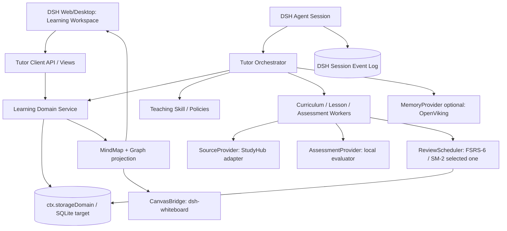
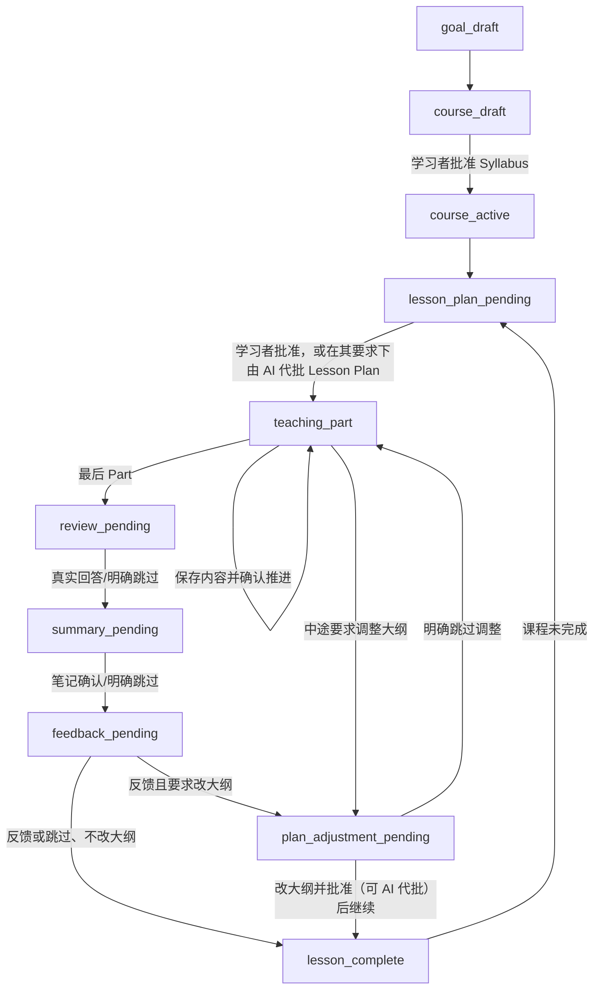

# 目标架构：dsh-oh-my-ai-tutor

## 1. 架构原则

1. **Learning Domain owns learning truth**：Goal/Course/Syllabus/KnowledgePoint/Lesson/Assessment 在本插件中统一管理；别的插件是可替换的能力提供方。
2. **Tutor control plane vs content workers**：阶段转换、确认门禁属于 Orchestrator；大纲生成、内容编写、评价、笔记生成属于可替换 Worker。
3. **四种资源独立，从属而不是等同**：课程大纲、知识点、思维导图、知识图谱各自是权威，用可选的从属（belongsTo）或引用（refersTo）关联，不绑成同一棵树、同一批节点。投影只负责展示，不负责定义对方的内容。大纲回答「教什么、按什么顺序」；图谱回答「要知道什么、如何依赖、如何判断学会了」。思维导图用适合自己的层次结构组织「要学内容如何展开」，深度不限。不要把导图做成大纲的 1:1 投影，也不要把导图做成图谱的一种视图。
4. **Coverage != mastery**：记录学过/看过与可迁移解答的证据；模型评分须标明不确定性，不捏造掌握概率。
5. **Snapshot + immutable evidence**：课程和概念有稳定 ID / revision，原始回答、引用、评分和关系提案保留可审计记录。
6. **Plugin compatibility**：优先使用 DSH Cordis API / StorageDomain / Client Slots / User Questions；避免修改 DSH core、读取第三方私有状态文件。

## 2. 目标分层



## 3. 核心领域对象（将原型 JSON 迁移到领域 Store）

| 对象 | 主要字段 | 关键不变量 |
|---|---|---|
| `LearningGoal` | `id,learnerId,title,outcome,profile,revision` | 目标可以拥有多门 Course |
| `Course` | `id,goalId,status,syllabusRevision` | 课程目录的批准与变更可审计 |
| `Topic/Subtopic` | `id,parentId,order,title,objective,sourceRefs` | 结构修改应保留旧 ID |
| `KnowledgePoint` | `id,title,aliases,description,courseLinks,version` | 独立的可教、可测、可复习对象池；不因更名更换 ID；不再等同于大纲条目或导图/图谱节点 |
| `KnowledgeRelation` | `id,fromId,toId,type,status,evidenceRefs,revision` | 关系端点存在；前置/包含关系不得有环；候选不自动确认 |
| `LearningSession/Lesson` | `id,courseId,dshSessionIds,plan,phase,currentPart` | 属于课程，业务阶段与 DSH turn 分离 |
| `LessonPart` | `id,title,objective,content,sourceRefs,status` | 有内容、用户确认才覆盖，不等于掌握 |
| `AssessmentEvidence` | `id,conceptId,lessonId,question,response,score,hints,rubric,origin,time` | 保存真实答案与实际提示；可追溯、不可猜测 |
| `LearnerConceptState` | `learnerId,conceptId,status,modelVersion,evidenceIds` | 进度状态与知识掌握状态分离 |
| `LearningNote` | `id,lessonId,anchors,conceptIds,body,author,sourceRefs,version` | 用户笔记与 AI 生成内容分开；anchors 可挂知识点、主题、导图节点、图谱节点/关系、课时 |
| `SourceRef` | `{sourceId,locator}`（旧自由文本仍可读） | 必须指向已登记 Source；locator 尽量带页码/时间；点击打开 URI |
| `CanvasBinding` | `courseId,boardId,owningSessionId,sceneRevision,conceptElementIds,relationElementIds` | 逻辑 ID ≠ 元素 ID；不能静默覆盖用户布局 |
| `ReviewItem` | `id,conceptId,questionId,scheduler,dueAt,reviewHistory` | 一条复习流仅有一个权威调度器 |

## 4. 生命周期状态机（目标）



原型（及当前实现）的阶段为 `plan_pending → teaching → review_pending → summary_pending → feedback_pending → complete`，课中/课后调整走 `plan_adjustment_pending`。批准是绑定 entity+revision 的 CAS 动作，默认由学习者在工作台发起；学习者说「交给你」「跳过批准」或打开「交给 AI 批准」时，AI 可以代为调用同一 `approve` 动作并记录 actor 与依据，但**不能**在写入大纲时自动生效，也不能在未经请求时自行批准。

## 5. 视觉模型：四种资源不可混淆

- `SyllabusTree`：严格父子树，显示计划、进度和目录；来自课程大纲。回答「教什么、按什么顺序」。改「教什么」仍须批准（ADR-009）。子主题用 `conceptIds` 引用知识点，而不是自己就是一个知识点。
- `MindMap`：独立存储、独立编辑的思考结构，深度不限；节点有自己的 ID，可 `belongsTo` 主题或知识点，也可以只是扩展。做课或首次打开时若还没有导图，可用当时大纲生成骨架，生成后即独立。改导图不是改大纲，也不走大纲批准。
- `KnowledgeGraph`：独立的图谱节点和带类型关系（`prerequisite/partOf/explains/contrasts/applies/exampleOf/relatedTo`）。节点可 `refersTo` 某个知识点，也可以为扩展单独存在。两端都引用了知识点的关系，可以同时作为教学上的 `KnowledgeRelation` 候选；候选不自动确认。支持跨章节、跨课程关系（跨课程仍须单独审核）。
- `KnowledgeWhiteboard`：可编辑的 `node/arrow/text/layout`，卡片可挂到第 5 节所述的更宽对象上，也可以是自由便签。白板的视觉箭头可能只是演示标记，**不得自动回写成已验证语义关系**（ADR-004）。

知识和学习记录的挂接：作答、掌握、复习只指向知识点。笔记、待办和白板可以挂到知识点、大纲主题、导图节点、图谱节点或关系、课时。导图或图谱上的扩展不自动成为考点；明确升格（`concept.promote`）之后，才可以出现在测验和复习里，且不自动写入大纲。

每种资源只保留一份协同结果，由学习者和 AI 一起改，留下的就是准绳。不做快照，也不做两套可切换的「课程版 / 我的理解版」。节点上可记下轻量来源（做课时产生的还是学习中补的、是谁改的），仅供阅读，不用来切换或回退。

生成（不是投影）也写入这一份：大纲批准后，或首次打开仍是骨架时，可根据课程目标、大纲、讲解和资料充实思维导图（`mindmap.generate`，只新增、不覆盖已有节点）和知识图谱（`graph.generate`，只新增节点和 candidate 关系）。白板播种（`board.seed` / `board.generate`）放入相关知识点（含已升格、大纲外的点）以及相关导图/图谱扩展（作为注释，不是考点），已有布局保留，只补缺失。生成导图、图谱或白板不重新打开大纲批准；改「教什么」仍走大纲批准。

### 数据变更原则

- 大纲重排：不重建 KPs，保留学习证据，只更新 `Topic/Subtopic.order`。
- 白板移动：只更新 layout，不改变关系。
- 白板新增连接：生成待审核 `KnowledgeRelation(candidate)`，要求选择关系类型/证据，确认后同步。
- 图谱新增关系：验证端点/环/来源，`candidate` 可以显示虚线；用户批准并校验后才变 `accepted`。
- 删除课程节点：不物理删除 KC/Assessment/Notes，软归档并保留来源。

## 6. Session 身份问题（关键）

`dsh-whiteboard` 的工具只能编辑**当前调用 Agent Session 所属**的白板。因此若一门 Course 有多个 Lesson DSH Session，不能直接拿别的 Session 的 boardId 去写入。

- **P0：** 知识图谱存在我们自己的 Store；`whiteboard-seed` 只是某个 Lesson Session 的投影。将 courseId 和 sceneId 留在 CanvasBinding。
- **P1 推荐：** 维护独立 `CourseBoard` 服务/Canvas UI（可复用 Excalidraw UI 和公开的数据转换思想），跨 Lesson 使用同一 `courseId` 权威知识白板；保留 dsh-whiteboard 作为外部可选的课程图形投影，使用其公开工具。
- **临时低成本路径：** 将一门 Course 的教学绑定到一个长期 DSH Session，保证其图板不散落在不同会话。弊端是长会话上下文、并发和课程/课时分组体验。

## 7. 数据同步与适配约束

- Host `TutorDomain` 保存权威学习数据；组件不直接互相读私有 JSON。
- `StudyHubAdapter` 在运行时发现 `studyRuntime`，检查 contexts/operation 版本和授权，提取 `documentId/sourceId/revision/locator/quote`；只缓存引用，不复制全部素材。
- `LookatStudyAdapter` 的原型先作为算法/样式参考；若未来复用插件，必须定义显式同步协议并解决 KC ID、评分/复习历史及线程映射，避免双写。
- `CanvasBridge` 利用 `whiteboard_list/read/patch`，带目标 session、boardId 与 CAS；任何失败都重新读取，不盲目重试。
- `ReviewScheduler` 独立接口，初期只能二选一：StudyHub FSRS-6 或 LookatStudy SM-2，不能两个同时给同一条题安排到期日。

## 8. 产品界面（Web / Desktop 共用模型）

```text
┌────────────────────────── DSH ─────────────────────────────────────────┐
│ 左导航：学习目标、课程、最近学习、今日复习                                │
├─────────────────┬───────────────────────────────┬─────────────────────┤
│ 课程树 / Syllabus│ AI Tutor 交互教学                │ 右侧知识工作台       │
│ 章节 / Knowledge │ 目标/计划/Part/Review 确认卡    │ Tabs:               │
│ 已学/未验收/弱项 │ 当前问题及学习者真实回答        │ 课程大纲             │
│ 时间与材料       │ 引用、反馈、迁移练习            │ 思维导图             │
│                 │                               │ 知识图谱             │
│                 │                               │ 课程知识白板         │
│                 │                               │ Lesson Notes         │
└─────────────────┴───────────────────────────────┴─────────────────────┘
```

第一版可仅在 DSH 常规聊天工具中跑状态操作；完整 GUI 应由独立 `dsh.client` 和 `ctx.slots` 实现，Host 保存数据，Client 订阅投影。Web 与 Desktop 使用相同的 Client 业务组件，但需分别完成 Profile/IPC/权限测试。

## 9. 真实开发中需要增加的系统能力

- SQLite 领域库 + 按实体版本 CAS。物理文件按工作区隔离，仍落在 `$DSH_HOME`（路线 B）：`$DSH_HOME/oh-my-ai-tutor/<workspace-key>/tutor.db`。锚点是会话不可变的 `SessionHeader.cwd`，禁止 `process.cwd()` 或后来 `cd` 后的目录。没有工作区时回退 `$DSH_HOME/oh-my-ai-tutor/tutor.db`。可配置 `dbPath`。现有全局库在首次打开某工作区时显式复制（先 0600 备份，不移动原文件）。工作区改名用 git 远程 / 包名指纹认领。JSON 回退库走同一套分桶，但不提供 FSRS / 待办。
- 工作区目录只放教材等素材，不把主库写成项目内的 `.oh-my-ai-tutor`。同一工作区的 web / headless 读同一份库；打开工作区 A 打不开 B 的进度。

- UserQuestion 审批令牌、用户实际回复验证和敏感写入防护。
- 多个 Source Provider 的 chunk/page/timecode 定位与引用证据质量检查。
- 模型 Worker 的版本化 Prompt、schema-constrained 输出、失败重试和中断恢复。
- 索引/KG 合并、关系冲突审核、领域模型迁移、备份与导出。
- 多阶段 Eval 与实际学习者实验，严格区分教学过程质量和学习增益。
