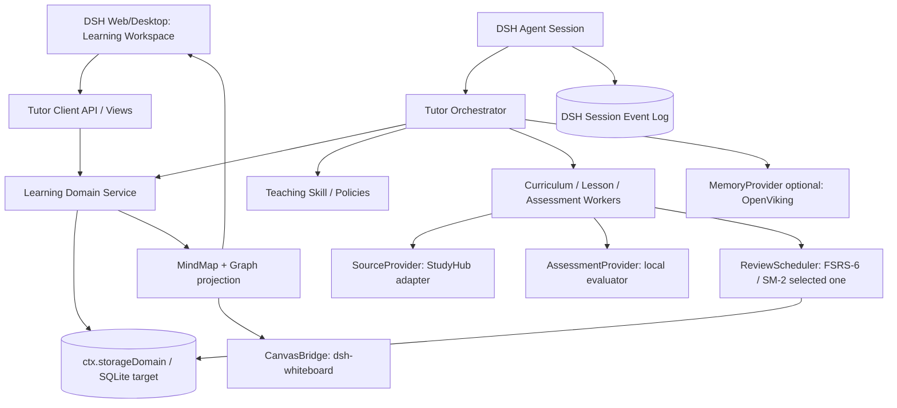
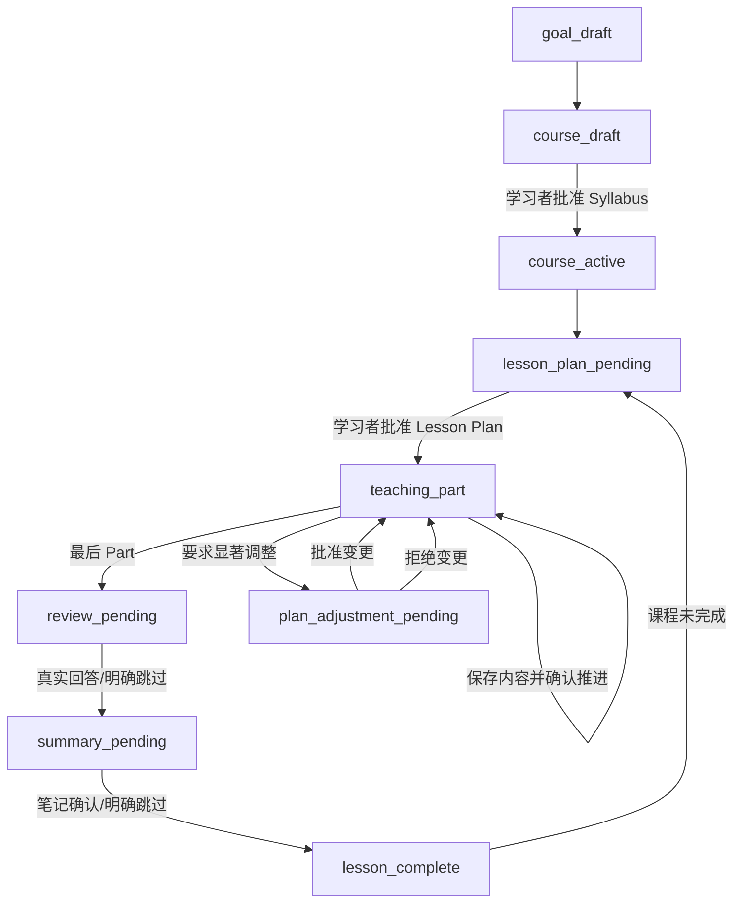

# 目标架构：dsh-oh-my-ai-tutor

## 1. 架构原则

1. **Learning Domain owns learning truth**：Goal/Course/Syllabus/KnowledgePoint/Lesson/Assessment 在本插件中统一管理；别的插件是可替换的能力提供方。
2. **Tutor control plane vs content workers**：阶段转换、确认门禁属于 Orchestrator；大纲生成、内容编写、评价、笔记生成属于可替换 Worker。
3. **One semantic graph, many projections**：课程目录是树，思维导图是树的视觉投影，知识图谱是有证据的有向多关系图，白板是可编辑图形布局。它们不互相代替。
4. **Coverage != mastery**：记录学过/看过与可迁移解答的证据；模型评分须标明不确定性，不捏造掌握概率。
5. **Snapshot + immutable evidence**：课程和概念有稳定 ID / revision，原始回答、引用、评分和关系提案保留可审计记录。
6. **Plugin compatibility**：优先使用 DSH Cordis API / StorageDomain / Client Slots / User Questions；避免修改 DSH core、读取第三方私有状态文件。

## 2. 目标分层



## 3. 核心领域对象（将原型 JSON 迁移到领域 Store）

| 对象 | 主要字段 | 关键不变量 |
|---|---|---|
| `LearningGoal` | `id,learnerId,title,outcome,profile,revision` | 目标可以拥有多门 Course |
| `Course` | `id,goalId,status,syllabusRevision` | 课程目录的批准与变更可审计 |
| `Topic/Subtopic` | `id,parentId,order,title,objective,sourceRefs` | 结构修改应保留旧 ID |
| `KnowledgePoint` | `id,title,aliases,description,courseLinks,version` | 不因更名更换 ID；跨课程去重需人工核对 |
| `KnowledgeRelation` | `id,fromId,toId,type,status,evidenceRefs,revision` | 关系端点存在；前置/包含关系不得有环；候选不自动确认 |
| `LearningSession/Lesson` | `id,courseId,dshSessionIds,plan,phase,currentPart` | 属于课程，业务阶段与 DSH turn 分离 |
| `LessonPart` | `id,title,objective,content,sourceRefs,status` | 有内容、用户确认才覆盖，不等于掌握 |
| `AssessmentEvidence` | `id,conceptId,lessonId,question,response,score,hints,rubric,origin,time` | 保存真实答案与实际提示；可追溯、不可猜测 |
| `LearnerConceptState` | `learnerId,conceptId,status,modelVersion,evidenceIds` | 进度状态与知识掌握状态分离 |
| `LearningNote` | `id,lessonId,conceptIds,body,author,sourceRefs,version` | 用户笔记与 AI 生成内容分开 |
| `SourceRef` | `id,documentId,revision,locator,quote,verified` | 原文/页码/时间戳能回溯；不可凭模型假造 |
| `CanvasBinding` | `courseId,boardId,owningSessionId,sceneRevision,conceptElementIds,relationElementIds` | 逻辑 ID ≠ 元素 ID；不能静默覆盖用户布局 |
| `ReviewItem` | `id,conceptId,questionId,scheduler,dueAt,reviewHistory` | 一条复习流仅有一个权威调度器 |

## 4. 生命周期状态机（目标）



原型具备 `plan_pending → teaching → review_pending → summary_pending → complete` 的数据状态，但**未建立真实用户身份绑定的审批令牌**。目标实现中 `approve` 接口必须接收由 DSH UI 用户操作产生、绑定 entity+revision 的 `decisionId`，不能由 Agent 自行生成。

## 5. 视觉模型：四层不可混淆

- `SyllabusTree`：严格父子树，显示计划、进度和目录；来自课程 Syllabus。
- `MindMap`：SyllabusTree 的可视化，输出 `id,title,children`，可生成 Mermaid 或 UI 的 ReactFlow 视图；仅反映“包含/课程层级”。
- `KnowledgeGraph`：独立的 `KnowledgePoint` 和 `KnowledgeRelation`，含 `prerequisite/partOf/explains/contrasts/applies/exampleOf/relatedTo` 与来源证据；支持跨章节、跨课程关系。
- `KnowledgeWhiteboard`：由图谱部分投影的 `node/arrow/text/layout`，包含讲课时的标注和用户自定义布局。白板的视觉箭头可能只是演示标记，**不得自动回写成已验证语义关系**。

### 数据变更原则

- 大纲重排：不重建 KPs，保留学习证据，只更新 `Topic/Subtopic.order`。
- 白板移动：只更新 layout，不改变关系。
- 白板新增连接：生成待审核 `KnowledgeRelation(candidate)`，要求选择关系类型/证据，确认后同步。
- 图谱新增关系：验证端点/环/来源，`candidate` 可以显示虚线；用户批准并校验后才变 `accepted`。
- 删除课程节点：不物理删除 KC/Assessment/Notes，软归档并保留来源。

## 6. Session 身份问题（关键）

`dsh-whiteboard` 的工具只能编辑**当前调用 Agent Session 所属**的白板。因此若一门 Course 有多个 Lesson DSH Session，不能直接拿别的 Session 的 boardId 去写入。

- **P0：** 知识图谱存在我们自己的 Store；`whiteboard-seed` 只是某个 Lesson Session 的投影。将 courseId 和 sceneId 留在 CanvasBinding。
- **P1 推荐：** 维护独立 `CourseBoard` 服务/Canvas UI（可复用 Excalidraw UI 和公开的数据转换思想），跨 Lesson 使用同一 `courseId` 权威知识白板；保留 dsh-whiteboard 作为外部可选的课程图形投影，使用其公开工具。
- **临时低成本路径：** 将一门 Course 的教学绑定到一个长期 DSH Session，保证其图板不散落在不同会话。弊端是长会话上下文、并发和课程/课时分组体验。

## 7. 数据同步与适配约束

- Host `TutorDomain` 保存权威学习数据；组件不直接互相读私有 JSON。
- `StudyHubAdapter` 在运行时发现 `studyRuntime`，检查 contexts/operation 版本和授权，提取 `documentId/sourceId/revision/locator/quote`；只缓存引用，不复制全部素材。
- `LookatStudyAdapter` 的原型先作为算法/样式参考；若未来复用插件，必须定义显式同步协议并解决 KC ID、评分/复习历史及线程映射，避免双写。
- `CanvasBridge` 利用 `whiteboard_list/read/patch`，带目标 session、boardId 与 CAS；任何失败都重新读取，不盲目重试。
- `ReviewScheduler` 独立接口，初期只能二选一：StudyHub FSRS-6 或 LookatStudy SM-2，不能两个同时给同一条题安排到期日。

## 8. 产品界面（Web / Desktop 共用模型）

```text
┌────────────────────────── DSH ─────────────────────────────────────────┐
│ 左导航：学习目标、课程、最近学习、今日复习                                │
├─────────────────┬───────────────────────────────┬─────────────────────┤
│ 课程树 / Syllabus│ AI Tutor 交互教学                │ 右侧知识工作台       │
│ 章节 / Knowledge │ 目标/计划/Part/Review 确认卡    │ Tabs:               │
│ 已学/未验收/弱项 │ 当前问题及学习者真实回答        │ 课程大纲             │
│ 时间与材料       │ 引用、反馈、迁移练习            │ 思维导图             │
│                 │                               │ 知识图谱             │
│                 │                               │ 课程知识白板         │
│                 │                               │ Lesson Notes         │
└─────────────────┴───────────────────────────────┴─────────────────────┘
```

第一版可仅在 DSH 常规聊天工具中跑状态操作；完整 GUI 应由独立 `dsh.client` 和 `ctx.slots` 实现，Host 保存数据，Client 订阅投影。Web 与 Desktop 使用相同的 Client 业务组件，但需分别完成 Profile/IPC/权限测试。

## 9. 真实开发中需要增加的系统能力

- `ctx.storageDomain`/SQLite、领域事务、按实体版本 CAS；P0 prototype JSON 只承诺进程内顺序写。
- UserQuestion 审批令牌、用户实际回复验证和敏感写入防护。
- 多个 Source Provider 的 chunk/page/timecode 定位与引用证据质量检查。
- 模型 Worker 的版本化 Prompt、schema-constrained 输出、失败重试和中断恢复。
- 索引/KG 合并、关系冲突审核、领域模型迁移、备份与导出。
- 多阶段 Eval 与实际学习者实验，严格区分教学过程质量和学习增益。
