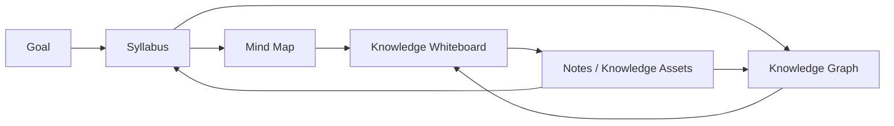
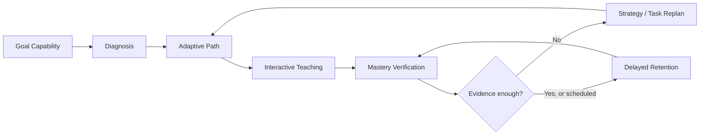

# PRD｜dsh-oh-my-ai-tutor：双闭环个性化学习增强（借鉴 Prova Learn）

> **文档状态**：需求建议稿（待产品评审，**不是已实施功能说明**）  
> **版本**：v0.1 · 2026-11-12  
> **目标分支**：`feat/editable-visualizations`  
> **代码审查基线**：`89a336ceabba9bbd903dfb739714bd8142a3d530`（2026-11-12）  
> **对照仓库**：`kms9/prova-learn@ce6c6fd536140031dfb96b98729765b9f28815a8`  
> **性质**：在现有 DSH 工作台上的增量 PRD；不得理解为要求整体迁移 Prova Learn，或重新实现 Heptabase UI。  
> **归档路径**：`docs/PRD_DUAL_LOOP_LEARNING_ENHANCEMENT.md`

## 0. 决策摘要

1. **产品体验以 Heptabase AI Tutor 为参照**：可随时问、随时学、随时改大纲、在知识图谱/白板上探索并回到课程；完整课程教学按需组织，不强制完成 Prova Learn 的 S1–S7 七阶段。
2. **两个独立、关联的闭环**：
   - **知识组织闭环**：目标 → 大纲 → 思维导图 → 知识图谱 → 白板 → 知识沉淀。
   - **学习能力闭环**：目标能力 → 学习者诊断 → 路径规划 → 教学交互 → 掌握验证 → 策略调整 → 延迟复测。
3. **继续以当前 DSH 插件 SQLite 工作区存储为权威数据源**；Prova Learn 的七阶段被转化为可组合的学习规则/策略服务，而非新的强制状态机或第二份 Wiki 真相。
4. **先修正“看过/答对=掌握”风险，再增强自适应**。正式掌握应由事先定义的测评规则与多项独立学习行为证据共同支持；FSRS 仅负责间隔调度，不提供能力认证。
5. **先稳定现有开发分支再实施增量**。截至本次审查，GitHub CI 单测通过，最新 E2E 50/51 通过；失败项为 FSRS 日期显示与测试期望相差一天，须优先排查时区口径。

---

## 1. 背景、问题与预期结果

### 1.1 背景

`dsh-oh-my-ai-tutor` 已建立由 DSH Agent 驱动的三栏学习工作台。最新分支包含：课程大纲手动/AI 编辑及 Diff、Mind Elixir 思维导图、React Flow 知识图谱与知识白板、稳定 Concept ID、Lesson Part 与知识点关联、候选知识关系、笔记卡、结构化来源引用、待答问题恢复、课末反馈、FSRS 复习、Todo/日历、SQLite v3、按 DSH Workspace 隔离的数据存储、用户审批及经授权的 AI 代审批。

这些能力较好地覆盖了 **知识的组织、显示、编辑和持久化**，但尚不足以证明其具备真正的个性化学习决策：目前缺少可执行的目标能力契约、系统性学习者诊断、按证据规划学习前沿、事先定义的掌握量规、跨任务的多证据判断、策略效果归因及重规划。

Prova Learn 提供 `S1目标成功契约 → S2领域取证 → S3能力-概念图谱 → S4学习者诊断 → S5路径规划 → S6教学交互 → S7掌握验证/重规划` 的教学规则与校验思想。其示例项目在 S4 等待真实作答，不能视作 S1–S7 已有真实学习者全流程效果验证；本项目只借鉴可解释、可验证的机制。

### 1.2 需要解决的用户问题

- 用户已有学习目标，但不清楚应先学哪部分、已有基础是否足以跳过哪些知识。
- Tutor 能讲授、出题、给评分，但**一次回答正确**、一次模型评分或读完一节不应等于稳定掌握。
- 大纲/图谱与教学活动虽然可以关联知识点 ID，但尚无稳定的 **目标能力—学习单元—知识点—诊断题—真实证据** 追溯链。
- 复习系统可以安排时间，但回答错误后缺少明确机制判断究竟应重讲、修正误概念、补先修、调整难度还是补充证据。
- 用户可能只是临时探索一个概念：如果每次强制研究、诊断和批准七阶段，将损害 Heptabase 式低摩擦体验。

### 1.3 产品目标与成功判据

**O1：保留低摩擦学习体验。** 用户从任意会话提出知识问题可直接获得解释，无须先建立 Goal、完成诊断或研究；可在需要时将讨论转成课程、笔记或知识点。

**O2：知识组织闭环独立可用。** 未启用能力诊断时，用户仍可创建/修改大纲、导图、图谱、白板和笔记，持久化结果在重启后可恢复。

**O3：学习能力闭环独立可用。** 不以绘制白板、生成完整大纲为学习证据前提；可对一个明确的能力目标直接做诊断、教学、复测和调整；评估记录始终能关联目标节点。

**O4：学习决策可追溯。** 对每个正式掌握声明，能看到预设规则、原始学习者回答、题目/子项、评分依据、是否使用提示、任务独立性、迁移/延迟证据、模型版本及决定理由。

**O5：适配现有项目且无破坏性迁移。** 现有课程、知识点 ID、关系、白板、Lesson/Note、FSRS 卡片和事件记录保持可读；升级后原始评分不被无依据提升为正式掌握。

### 1.4 非目标

- 不把七个 Prova Learn Skill 原封不动安装为七个页面或七个必须完成的步骤。
- 不复制 Prova Learn 的整套项目 Wiki 文件作为 DSH SQLite 以外的第二份权威状态。
- 不以「学习者自称懂了」「一次选择题答对」「AI 给出 95%」「读完内容」「FSRS 到期」作为正式能力掌握证明。
- 不把 Mind Map 的父子层级、白板视觉箭头或几何距离直接认定为先修/因果关系。
- 首版不实现经大规模真实数据校准的 IRT/BKT/DKT 模型，不承诺教育效果提升比例。
- 不要求每门课程先做六通道完整网络研究；高风险/有争议的主张才要求更强的证据检验。

---

## 2. 本次代码审查基线：已经有的能力与真实缺口

> 下述“已实现”指仓库当前源码存在相应逻辑，且部分由 CI 测试验证；**不代表生产质量、全量浏览器实测或真实学习效果验证**。

| 业务域 | 已在 `feat/editable-visualizations` 体现 | 仍需补充 / 说明 |
|---|---|---|
| 目标/课程 | `goal.create`, `course.create`, 课程确认、修订历史 | Goal 是结果描述，不是具有可观察行为/最终验收的成功契约 |
| 大纲/导图 | Syllabus 双层结构、Mind Elixir、原子编辑、Diff、CAS、保留 ID | 需要“能力/学习单元/知识点”多对多映射；目录顺序不代表先修 |
| 图谱/白板 | React Flow、类型化候选关系、卡片/便签/连线、布局编辑 | 已有关系不等于已验证先修；关系需依据与审核状态；跨课程合并仍未实现 |
| 教学 | `lesson.create/approve/partWrite/cover`、`lesson.ask/hint/checkpoint`、反馈及恢复 | 内容交付阶段不等于已形成能力；尚无根据误概念选择策略的明确决策器 |
| 测评 | `assessment.record` 保存问题、回答、评分、提示次数和 `transfer` 标记 | 未按子项建模独立性、评分量规、混淆因素与证据可靠性；单次回答可赋予暂定 `demonstrated` |
| 笔记/来源 | `note.add/link`、来源登记、`sourceRefs` 与可点击链接 | `source.register` 仅登记，不表示资料已真实读取或引用已核验 |
| 复习/待办 | `ts-fsrs` 每知识点复习卡、评分、Review Log、日历 | 复习排期与掌握认证需分离；现有 E2E 日期断言失败仍待修复 |
| 持久化 | SQLite v3、revision/CAS、Workspace 单独存储和迁移 | 扩展需要前向迁移、证据事件、版本失效机制和隔离测试 |
| 用户权限 | 默认用户确认；在用户明确授权下可由 AI 代批课程/课时计划 | 不可把授权代批扩展为代替用户答题、伪造确认或自动给出正式掌握 |

**源码级风险**：`src/core.mjs` 的 `assessment.record` 目前使用 `score >= 0.8 && transfer && hintCount === 0` 将知识点写为暂定 `demonstrated`。这不是正式多证据掌握判断，后续应避免在视图、路径规划或迁移中将它误认为 `tested_mastered`。

**CI 现状**：最新 GitHub Actions run `43147305223`：Unit 成功、E2E 50/51，通过率不能替代教学正确性。未通过断言：FSRS 下一次复习日期在浏览器/测试进程之间相差一天；先统一学习者时区、UTC 日期与测试时钟再合并后续改动。

---

## 3. 产品体验原则：Heptabase 优先、Prova Learn 规则内化

### 3.1 三种渐进式学习用法（不是七步向导）

| 使用方式 | 学习者入口 | 默认过程 | 是否必须建课 / 先诊断 |
|---|---|---|---|
| **Explore 探索** | “帮我理解 ZPD”“解释这张图” | 直接回答 → 追问/展开 → 可选保存笔记/添加知识点/转课程 | **否 / 否** |
| **Guided 结构化学习** | “用这些资料带我系统学习” | Goal → 大纲草稿与确认 → 选 Lesson → 讲解/检查/笔记/续学 | 有 Course；**诊断可跳过** |
| **Mastery 能力达成** | “我最终要能独立设计教学策略” | 成功契约 → 目标相关诊断 → 个性化路径 → 教学 → 独立/迁移验证 → 延迟复测 | 能力验收需要证据；仍**不要求机械经过 S1–S7 UI** |

- 同一 Goal/Course 可以从 Explore/Guided **升级**到 Mastery；升级只影响后续验收标准，已产生的低质量证据不能追认为正式掌握。
- 模式切换可以被学习者撤销；关闭 Mastery 不应删除已有诊断和证据，也不能自动把节点标为掌握。
- Tutor 始终允许随时插入问题、调整深度、更换讲解方式、跳出当前课时、返回白板；只有需要写入领域真相或作出不可逆判断时使用必要确认。
- 默认展示课程或讲解的有用结果，不先弹多个表单。对缺失的高影响信息可在需要时只问最少的问题。
- 保留当前“普通对话”与“显式 Tutor 学习状态”的区分：普通问答不会悄悄创建新能力认证或修改成绩。

### 3.2 必须分开的状态

1. `coverage/progress`：内容是否讲授、阅读、标记完成。
2. `attempt/performance`：具体任务的回答、正确性、提示、理由及观察条件。
3. `mastery_evidence_status`：该能力是否已经有足够且有效的证明。
4. `review_schedule`：FSRS 何时推荐再次提取练习。

“完成 Lesson”只更新 1；“作答一次”只新增 2 并可能更新候选状态 3；“FSRS 给出下次日期”只更新 4。不得相互偷换。

### 3.3 需要的门禁是**决策门禁**，不是**导航门禁**

- 可以自由浏览、学习、记笔记、探索图谱，不需 G1–G7 全通过。
- 课程大纲/教学计划的修改继续遵守现有 revision + 用户确认/明确授权代批。
- **正式掌握声明**要求事前定义的量规和真实行为证据；不足则返回“候选/不足”，而不是禁止学习。
- **权威来源/先修断言**未经核验只显示候选；允许继续讲解，但不得标成已验证事实。
- **能力目标已达成**只在其必需验收项和必要的延迟保持证据确实齐备时可声明；否则提示未完成项。

---

## 4. 双闭环完整用户流程

### 4.1 知识组织闭环（Knowledge Organization）

- Goal 与 Syllabus 负责组织与学习计划的**表现形式**，不负责判断掌握。
- Mind Map 是 Syllabus 的投影；同步增删改/重排，原子实体 ID 不变。
- Knowledge Graph 维护候选/已确认关系、来源和语义版本；不能根据目录顺序推断先修。
- Whiteboard 是可编辑的空间视图，记录视觉箭头、布局和笔记卡，不能把视觉动作直接认作已验证语义。
- Knowledge Assets 保存学习者笔记、AI 笔记、来源、卡片和讨论链接，可反向关联 Course 与 KnowledgePoint。
- **独立性要求**：不进行诊断或答题，也可以完整使用这条闭环。用户可从任意节点开始（例如先记笔记再整理为大纲），上图只表示推荐组织过程。

### 4.2 学习能力闭环（Learning Competency）

- Goal Capability 描述“学会后能做什么”，允许从用户意图中逐步补齐。
- Diagnosis 仅在有价值时进行；未诊断节点保持 `unknown`，不能推断为未掌握。
- Adaptive Path 从当前证据和真实前置关系选择下一任务，支持学习者主动覆盖默认顺序。
- Teaching 按目标知识类型与缺口选教学方法、题型、提示和撤架策略。
- Verification 验证的是**能力表现**，不等于模型已经写完内容；不足时明确缺哪种证据。
- Retention 使用 FSRS 的复习时间作为调度依据，但真正保持情况由延迟后的**实际作答**决定。
- **独立性要求**：即使用户没有建立课程白板，也能直接对一个目标能力开展诊断/教学/验证（必要时系统可创建最小临时能力节点）。

### 4.3 两条闭环仅通过明确接口互联

| 事件/对象 | 组织闭环产生/维护 | 能力闭环可消费/回写 | 禁止行为 |
|---|---|---|---|
| `KnowledgePoint ID` | 概念身份、标题、语义版本 | 诊断题、回答、能力状态、复习引用 | 更名或拖动后重建全部掌握证据 |
| `PrerequisiteRelation` | 候选/核验后的关系与版本 | 用于路径约束、补先修建议 | 将目录父子线当作硬先修 |
| `SourceRef` | 文件/网页及原文定位 | 用于教学解释、题目依据 | 仅登记来源就宣称已验证 |
| `Lesson/Note` | 课时、笔记与概念链接 | 承载观察情境和策略实施记录 | 阅读内容就视为独立作答 |
| `LearnerObservation` | **不修改**知识结构 | 真实答题、提示、时间、评分事实 | 把答案分数写回图谱当语义事实 |
| `MasteryDecision` | 只显示派生状态、弱点颜色 | 按证据/规则生成和维护 | 用户移动节点导致掌握状态变化 |
| `ReviewDue` | 白板/日历/列表显示提醒 | FSRS 排期和复测入口 | 到期或未复习自动认定掌握/遗忘 |

**同步策略**：统一 SQLite 中 ID、修订号、追加证据事件；两条闭环使用分别的状态机。共享对象变化通过显式事件使下游读模型过期、重算或请求复核；禁止前端视图直接修改另一条闭环的核心状态。

---

## 5. Prova Learn S1–S7 的取舍与映射（需求来源）

| Prova Learn 参考 | 在新产品中的模块/策略 | 触发条件 | 使用原则 | 优先级 |
|---|---|---|---|---|
| **S1 目标成功契约** | `GoalSuccessContract`：场景、可观察结果、验收标准 | 创建 Guided/Mastery 或用户表达“学会/能做” | Explore 可只存一句目标；重要验收条款再确认 | P1 |
| **S2 领域取证** | `SourceGroundingPolicy`：来源、独立性、争议、适用条件 | 上传教材、要生成知识关系/测评、需要权威结论 | 分级取证；普通解释不强制六通道研究 | P2 |
| **S3 能力—概念图** | `CapabilityGraph` + Unit–KP 关联 + 评估映射 | 用户要求能力达成、课程结构重构 | 目录/覆盖/先修语义分离；原子节点稳定 | P1 |
| **S4 学习者诊断** | `DiagnosticService` + `LearnerFrontier` | 用户主动诊断、能力路径不确定、明显失配 | 先短筛查，再针对性探针；无回答保持 unknown | P1 |
| **S5 路径与策略** | `LearningPolicyEngine` + `LearningPath` | 形成前沿、教学遇阻、用户要求规划 | 参考最近学习前沿和先修，支持人工跳过/调整 | P1–P2 |
| **S6 教学交互** | `InstructionStrategy` + Hint/Scaffold Trace | 每次 Lesson/解释/练习 | 按需使用 worked example、对比、苏格拉底提问和撤架；记录真实执行 | P1 |
| **S7 掌握与重规划** | `MasteryVerifier` + `ReplanDecision` | 新观察、阶段性总结、延迟复测后 | 多证据判断，归因后选择补救；缺证据绝不伪称达成 | P0–P1 |

**不迁入**：强制的七步用户向导、每节课七次 Gate、运行前必须完成领域研究、Prova Wiki 的文件目录/阶段工作流作为第二权威、统一强迫全部学习者做最终综合考试。

---

## 6. 功能需求：知识组织闭环

### K-01 目标、大纲与导图连续可编辑（现有增强）【P0 保持兼容】

- 保留现有 `goal.create`、`course.plan`、`course.editOutline`、Diff、CAS 与委托批准。
- 大纲与导图对同一个 Course Syllabus 修订号，知识点稳定 `conceptId`；删除使用退役语义，不抹除已做过的题与历史笔记。
- 无学习者诊断也允许创建、保存、调整、审批和浏览知识内容。
- **验收**：修改大纲后导图同步；切换学习模式不重建知识点；审批仍绑定确切 revision。

### K-02 可测评能力层与学习单元映射【P1 新增】

- 新增 `Capability`（能够独立完成的目标行为）、`LearningUnit`（可教学/可测评的学习单元）、`UnitConceptMapping`（`core/supporting/extension`）。
- 同一知识点可用于多个 LearningUnit；映射多对多、有原因和版本。
- 区分 **能力包含/学习单元覆盖/知识先修** 三类关系。课程目录的显示顺序不能直接成为先修依赖。
- 每个必需能力至少能追踪到相关核心知识点或表现任务；允许探索模式尚未完成映射，标记 `unmapped` 而非阻断编辑。
- **验收**：一个概念支持两项能力时 ID 唯一，两个单元都能引用；结构变动不会错误复制学习记录。

### K-03 关系治理与语义版本【P1】

- 延用 `relation.propose` 的 candidate 概念；明确 `candidate/accepted/rejected/stale` 状态与 `sourceRefs`、提出者、审核依据。
- 增加硬/软先修区分及无环性校验；未核验关系可展示但不驱动强制跳过或阻断学习路径。
- 标题更改/位置移动保留 ID；当节点**语义实质改变**时创建新语义版本或替代 ID，并将依赖旧版本的测评/前沿标为 `stale`，不自动继承掌握。
- **验收**：白板绘制箭头不会静默把 `candidate` 改为 `accepted`；重排 Syllabus 不会伪造先修。

### K-04 知识笔记、白板与可追溯来源【P1】

- 保留独立的 AI Note/用户 Note 作者、来源、Lesson/Concept 关联与内部跳转；支持探索对话中“保存为知识笔记”“转为课程大纲”。
- `SourceRef` 必须区分 `registered`、`retrieved`、`verified`（分别是来源登记、确实读取、引用对照）。
- 大纲、导图、图谱、白板仍为多个 UI 投影，共享结构化对象 ID；布局只读写视觉层。
- **验收**：同一 KP 从课程目录、白板、图谱、笔记链接都能定位；无来源时显示“待核实”，不得编造页码。

---

## 7. 功能需求：学习能力闭环

### L-01 成功契约是可选增强，而非学习前置障碍【P1】

- Guided/Mastery 目标可补充 `{scenario, observableOutcomes, acceptanceRules, requiredTransfer, requiredRetention, constraints, agreedAt, revision}`。
- 允许先学习后完善成功契约；未填高影响字段时只限制**最终“目标已达成”声明**，不限制解释、讨论、笔记或课程编辑。
- 若用户更改最终验收条件，生成新版本，保留旧判断与实际观察；不能用事后调整标准提升已经取得的成绩。
- **验收**：用户只说“给我解释 ZPD”立即学习；用户说“我需要能够独立设计策略”则显示可观察验收建议并可确认。

### L-02 冷启动诊断与学习前沿【P1】

- 默认建议一次 **8–12 分钟高信息短筛查**，但用户可跳过、缩短、按需开始 Lesson，也可针对单个概念直接测。
- 先选最能帮助确定前沿的关键节点；仅对猜对嫌疑、先修未知、结果冲突、提示依赖不明再追加探针。
- 诊断题有目标 `capabilityId/conceptId`、指标、评分依据；长题拆可独立评分的子项。
- 状态至少分 `unknown / insufficient_evidence / candidate_mastery / partial / tested_not_mastered / tested_mastered / stale`。
- **验收**：无答案保持 `unknown`；没有完整诊断也能学；系统说明为什么建议补测一个节点。

### L-03 有解释的动态学习路径【P1】

- 基于成功契约、已确认先修、LearnerFrontier、未测节点、不足证据以及用户时间约束，选择下一条**最小必要学习路径**。
- `unknown` 不等于不懂：关键未知先修应安排小探针而非直接增加大段补课；已经有有效证据的节点可建议跳过，但允许用户主动复习。
- 对比理由包括 `whyThisNext`, `skippedByEvidence`, `unknownToProbe`, `alternativeNext`。用户可调整顺序/难度，调整后保存策略原因，但不能伪造已完成状态。
- 默认不因学习者偏好的“视觉型/听觉型”自述而假定某教学方法更有效。
- **验收**：同一课程不同诊断证据得到不同合理建议；未诊断仍能按大纲学习。

### L-04 教学策略选择与执行记录【P1】

- 现有 `lesson.ask/hint/checkpoint`、分段教学、课末反馈保留，新增对具体知识点的 `strategyId`、选择理由、适用/禁用条件。
- 初版策略集：`direct_explanation`、`worked_example`、`socratic_questioning`、`contrastive_example`、`guided_practice`、`scaffold_fading`、`teach_back`、`independent_application`、`transfer_task`。
- 真正使用的提示记录为 `none/light/medium/strong/worked_example`，不能以计划的提示代替实际提示。
- 模型必须区分“示范”“有提示练习”“无提示独立任务”，学生被提示后在同题答对只形成依赖提示的候选证据。
- **验收**：连续答错或请求换讲法时可记录策略切换原因；从新对话恢复时保留当前未答问题和提示历史。

### L-05 真实行为证据与评分契约【P0 优先】

- `AssessmentItem` 预先定义 `indicator`, `rubricVersion`, `targetIds`, `itemType`, `independenceRequirement`, `transferRequirement`, `threshold`；复合题允许按 `subItemId` 评分。
- `LearnerObservation` 记录原始回答、关联 `sessionId/questionId/subItemId`、真实提示、分数/推理、是否独立、允许工具、参考来源、迁移标记、时间与混淆因素。
- `origin` 明确区分 `learner_behavior` 与 `synthetic_learner_behavior`、`model_generated`、`self_report`；fixture 永远不能进入真实掌握汇总。
- AI 的评分标注 `judge=model_unverified`（可扩展人审/规则验证）；不得将模型的自述置信度当作已校准的正确性概率。
- 原始观察只追加/纠错留痕；不覆盖历史记录。模型重新评分应生成新判定版本而非覆盖旧行为。
- **验收**：无真实回答不得记录 learner behavior；可追溯每次评分到输入和评分依据；同一次回答不会重复驱动 FSRS。

### L-06 多证据掌握决策与状态迁移【P0 优先】

- 正式 `tested_mastered` 默认要求：**两项相互独立、满足量规的有效观察**，或 **一项完整表现任务 + 一项无提示迁移/必要的延迟复测**；任务有效性、独立性和评分标准需明确。该默认规则按目标难度配置，不能见答案后放宽。
- 按维度呈现 `correctness/reasoning_quality/hint_dependency/independence/transfer/confidence_calibration/delayed_retention`。
- 单次高分或当前 `demonstrated` 迁移为 `candidate_mastery` 或 `legacy_unverified`，**不能直接转正式 mastered**。
- 输出 `MasteryDecision {status, evidenceIds, rubricVersion, rationale, missingEvidence, decidedAt, supersedes, learnerModelVersion}`。
- 证据不足应能正常结束当前 Lesson、安排待办/继续学习，而非把课程卡死在“不能过关”。只有用户主动要求能力认证或完成 Mastery Goal 时，才执行严格完成门。
- **验收**：单题 100 分不成为正式 mastered；提示后正确不会冒充独立迁移；正式通过可展示证据链并允许人工质疑。

### L-07 复习调度与延迟保持分离【P0 稳固 / P1 增强】

- 继续使用现有 `ts-fsrs` 每知识点卡片、CAS、日志、待办/日历；不重建第二套调度算法。
- `review_schedule` 只决定到期日；`retention_observation` 必须来自到期后的真实题目或主动回忆，才可影响保持证据。
- 同一行为事件以 `observationId` 幂等地更新：学习证据只新增一次，复习调度最多触发一次。
- 明确 `due_at` 的 UTC 存储、学习者时区展示和日历日期比较口径；UTC/浏览器/Node 进程跨天时的测试必须一致。
- **验收**：到期未作答不自动“遗忘”；按时复习正确也不自动覆盖复杂能力的独立迁移要求；修复当前 CI 11月14日/11月15日失败。

### L-08 有归因的适应性重规划【P1】

- 学习结果不理想时生成 `ReplanDecision`，理由至少区分：
  - `EVIDENCE_INSUFFICIENT`（缺独立或延迟证据）→ 复测；
  - `MISCONCEPTION_OR_KNOWLEDGE_GAP` → 对比/补讲；
  - `STRATEGY_OR_SEQUENCE` → 换教学方法/顺序；
  - `DIAGNOSIS_GAP` → 局部重诊断；
  - `GRAPH_OR_ASSESSMENT_GAP` → 审查知识点粒度、先修或题目；
  - `SOURCE_GAP` → 重新核查资料；
  - `GOAL_CHANGED` → 更新成功契约。
- 每次显示**建议与理由**，不是强制把用户导航回某个 S 阶段；用户可接受、调整或暂不执行。
- 重大变更须保留现有大纲 Diff 和修订确认/授权；局部补救不需要重新批准整门课程。
- **验收**：连续失败后有具体下一步，不只是重复同一解释；若失败来自无效题目，不应降低真实能力状态。

### L-09 跨会话恢复与工作区隔离【P0 保持】

- 维持 `TutorStoreHub` 根据 `SessionHeader.cwd` 关联工作区、数据只在 `$DSH_HOME/oh-my-ai-tutor` 下；不能由当前 shell 工作路径决定归属。
- 恢复信息保留当前课程、Lesson、Part、未答问题、实际提示、当前策略、待复测计划；切换工作区不能无提示合并学习档案。
- **验收**：Workspace A/B 各自的学习和证据独立；关闭 DSH 重启后能继续未答题；不存在无意的重复观察。

---

## 8. 交互与信息架构（复用现有工作台）

### 8.1 推荐布局

| 区域 | 继续保留 | 建议新增的轻量入口 |
|---|---|---|
| **左侧课程区域** | Goal、课程树、当前 Lesson、进度 | “本次建议”及已确认/待验证能力数；不展示七个 S 阶段任务队列 |
| **中间 Tutor 对话** | 直接提问、分段教学、作答、课末反馈 | “先测一下”“换一种讲法”“给我一个迁移题”“为什么推荐这节课”“继续上次” |
| **右侧工作台** | 大纲、思维导图、图谱、白板、数据/日历 | 数据下新增“学习状态/证据”，图谱可选着色显示未知、候选、已验证、待复测 |
| **对象详情抽屉** | 原文、课程、白板、笔记、作答、复习 | 可观察目标、最近证据、实际提示、掌握理由与下一步 |

### 8.2 具体交互约束

- 初次打开不弹七步向导；在用户开始建立课程时提供“我了解一些/从零开始/先诊断一下”的低负担选择。
- 学习者随时可直接跳到某个知识点，Tutor 根据相关记录解释；不要求先通过上游全部 Gate。
- 系统建议诊断时解释“能省掉哪些不必要的学习”；用户拒绝后仍可以开始课程。
- 任何“已掌握”“目标完成”应可点击查看证据；候选/未知和已验证使用不同文案，避免仅靠颜色表示。
- 讲解过程中不强制弹出 Knowledge Graph；若用户选择，可一键切换并定位本 Part 所关联的 KP。
- 已委托 AI 批准课程/课时计划的行为保持兼容；对于“替学习者作答”“更改评分规则”“宣布 Mastery Goal 达成”等不能因该委托而绕过真实行为要求。
- 因来源、图谱或测评变更产生的受影响知识点，用局部提示或 Diff 显示；不清空现有白板布局。

---

## 9. 领域数据与接口：建议的增量设计

### 9.1 权威与迁移

- 维持现有 `SqliteTutorStore`、Workspace 隔离、事务/CAS/事件日志。新增表及索引通过下一次**显式版本化迁移**，不修改旧表历史含义，不直接导入 Prova Learn 的 `workspace/**` Wiki。
- 旧 `concept.mastery=demonstrated` 保留为旧显示标签/待迁移候选；新增正式状态**只能由多证据判定器写入**，不得通过简单字段转换自动提升。
- 提供读视图供工作台使用；禁止由前端直接改掌握状态或手工覆盖原始观察。

### 9.2 新增领域对象（建议表）

| 建议表 | 主键/关键字段 | 作用 |
|---|---|---|
| `goal_success_contracts` | goal_id, version, scenario, outcomes_json, acceptance_json, confirmed_at | 可观察能力、目标及验收历史 |
| `capabilities` | id, goal_id, outcome, version, status | 目标能力实体 |
| `learning_units` | id, course_id, capability_id, objective, status | 可测评学习单元，不等同于 Topic |
| `unit_concept_mappings` | unit_id, concept_id, role, rationale, version | 多对多覆盖映射 |
| `assessment_items` | id, target_ids, rubric_json, independence_rule, version | 事先定义的题目/子项与验收规则 |
| `learner_observations` | id, learner_id, concept_id, item_id, session_id, answer, score, hints_json, origin, judged_by, recorded_at | 真实观察与评分事实，追加式 |
| `mastery_decisions` | id, learner_id, concept_id, status, evidence_ids_json, rubric_version, model_version, rationale, decided_at | 可审计正式掌握判断 |
| `learning_frontiers` | id, goal_id, snapshot_version, node_states_json, unknowns_json, created_at | 当前学习前沿快照 |
| `learning_paths` | id, goal_id, snapshot_version, steps_json, reasons_json, accepted_at | 建议路线与用户确认 |
| `instruction_runs` | id, lesson_id, strategy, reason, hint_trace_json, started_at, ended_at | 实际策略、撤架和过程记录 |
| `replan_decisions` | id, goal_id, cause, evidence_ids_json, proposal_json, user_decision, created_at | 失败归因和调整历史 |

**实现不要求一次性建满上述所有表**：可先增量新增 `learner_observations/mastery_decisions`、必要的成功契约字段，再按功能模块细分。具体数据库迁移必须由现有 DB v3 基线的 schema 测试确定。

### 9.3 原子状态与事件约定

事件建议包括 `GoalContractUpdated`、`UnitConceptMapped`、`DiagnosisObserved`、`StrategySelected`、`LearnerAnswered`、`AssessmentJudged`、`MasteryDecisionRecorded`、`ReplanProposed`、`ReviewRated`、`RetentionObserved`。

要求：`eventId` 唯一；记录 `workspaceKey / courseId / conceptId / learnerId / actor / source / baseRevision / timestamp`，能区分真实和模拟事件；`assessments` 原始记录及原文引用不得因重新规划而删除。

### 9.4 DSH Tools 与现有接口兼容

- 继续使用 `tutor_read`、`tutor_write`、`tutor_visualize`、`tutor_outline_edit`、`tutor_board_read/patch`、`tutor_review_rate`、`tutor_table_query`、`tutor_todo`。
- **建议增加按业务职责划分的操作**（可以作为现有工具的 `action`，无需强制增加大量模型工具）：
  - `goal.successContract.get/update`
  - `capability.map/get`
  - `diagnostic.plan/submit`
  - `learning.path.suggest/accept`
  - `strategy.select/record`
  - `assessment.item.create/recordObservation`
  - `mastery.evaluate/getEvidence`
  - `replan.propose/accept`
  - `retention.record`
- 每个操作应声明输入、返回、是否写库、actor 许可、expectedRevision、幂等键和何时不得运行；UI 的“开始学习”不能被误写成自动“创建正式诊断证据”。
- Skill 只决定何时调用与如何解释，**关键状态规则在领域代码中判定**，避免 Prompt 声称的门禁无法在运行时执行。

---

## 10. 关键验收用例（可直接转单测/E2E）

| 编号 | 情境 | 预期（必须自动检查） |
|---|---|---|
| AC-01 | 新用户只问“ZPD 是什么？” | 直接解释，无 Goal/七阶段/诊断前置弹窗 |
| AC-02 | 用户只创建大纲/导图/白板，不回答题 | 组织闭环可保存，能力节点仍 unknown/unverified |
| AC-03 | 只针对一项目标能力直接诊断，没有课程白板 | 可生成诊断记录并建议下一步；不要求先绘图 |
| AC-04 | 用户跳过诊断开始 Lesson | 允许教学，未知节点保持 unknown，不显示“全部不会” |
| AC-05 | 一次无提示迁移题 100 分 | 记录候选，**不得正式 tested_mastered** |
| AC-06 | 学习者使用 strong hint 后答对 | 保存实际提示，不计为完全独立证据 |
| AC-07 | 同题重复两次答对 | 若不满足独立性，不能凭计数晋升 mastered |
| AC-08 | 两项独立任务满足预设规则 | 可记录 tested_mastered，且可查看来源/量规/答案/版本 |
| AC-09 | 延迟复测尚未发生，目标要求长期保持 | 不得宣布 GOAL_ACHIEVED；可继续浏览与学习 |
| AC-10 | 修改知识点**标题**或白板位置 | ID、历史记录、证据有效性保持 |
| AC-11 | 修改知识点**语义**或关键先修边 | 受影响测评/前沿标 stale；展示影响面，保留旧版本 |
| AC-12 | AI 仅提出关系候选或绘制视觉连线 | 关系仍 candidate，不能强制用于路径跳过 |
| AC-13 | 课堂出题、记录回答、FSRS 复习 | 同一次真实事件不重复建作答和排期；不因到期自动判遗忘 |
| AC-14 | 回答失败源于题目错误 | 提示修题/重测，不简单降低学习者能力 |
| AC-15 | 用户要求临时更换讲解方法 | 记录策略变更，不强制回到“目标确认”阶段 |
| AC-16 | 学习者明确委托 AI 批准大纲 | 允许 revision 绑定的代批，但不允许代答/伪造掌握 |
| AC-17 | DSH 重启，Workspace A/B 切换 | 两者学习记录隔离，pendingQuestion 可恢复，不重复入库 |
| AC-18 | fixture / synthetic 作答注入 | 不可进入真实 mastery_decisions 或 learner snapshot |
| AC-19 | 时区跨 UTC 日期边界 | 复习日期、日历与详情一致；修复最新 E2E 日期失败 |
| AC-20 | 完成 Lesson 但 Review 被跳过 | 教学进度可完成，掌握状态不因完成而提高 |
| AC-21 | 现有 v3 学习库升级 | 不丢原始课程/答题/笔记/复习；具备备份与迁移回退证据 |
| AC-22 | 用户切换 Guided → Mastery | 保留原资产，新验收从此刻生效，不追认低等级旧证据 |

> **关键门禁**：AC-01/02/04/05/06/07/09/10/16/17/18/19/20/21 任一失败，不得宣称“双闭环 MVP 完成”。

---

## 11. 增量实施计划（不改造现有大框架）

### M0：基线与测试稳固【优先执行】

- 修复/明确最新 E2E 的 FSRS 日期跨时区断言；使用固定测试时钟及学习者时区，而不是 Node 本地时区推断浏览器日期。
- 锁定当前 `feat/editable-visualizations` 的工作台与 SQLite v3 迁移兼容测试；确认“单工作区/不同 Workspace”读写行为。
- 输出功能对照测试：Goal、Course、Approval、Part、Question、Note、Feedback、Resume、Mind Map、Graph、Board、FSRS。
- **完成标准**：Unit / E2E 全绿，现有 UI 与数据库没有回归。

### M1：把学习证据从评分中解耦【第一批真正的新需求】

- 新增 LearnerObservation 与 MasteryDecision，统一状态与证据来源分类。
- 修改 `assessment.record` 的下游掌握投影：保留旧值但正式 mastery 只能由多证据规则产生。
- 兼容旧数据库；引入具备版本/事件追溯的判断器；增加 AC-05～09/18/20/21。
- 工作台显示“待验证/证据不足/已验证”和支持证据明细，不通过颜色或百分比暗示超出证据的确定性。
- **完成标准**：单题、提示和模拟用例不能越权晋升正式 mastered；课堂与 Notes 工作流不被阻断。

### M2：能力映射、轻量诊断与可解释的路径【第二批】

- 能力 Goal Contract、LearningUnit–KnowledgePoint 多对多映射、原子诊断题/子项。
- 允许用户从 Explore → Guided/Mastery；实现短筛查和有针对性的补测。
- 用已核验先修和现有能力前沿推荐下一步；用户可直接跳过建议，仍能自由学。
- **完成标准**：AC-01～04/10～12/22 通过；知识组织工作不依赖诊断。

### M3：策略适配与 Review 重规划【第三批】

- 新增教学策略选择、实际提示链和策略切换理由。
- 由证据不足、误概念、先修缺口、内容错误等原因推荐不同的补救行动。
- 利用现有 Lesson Feedback、Resume、Todo、FSRS 实现延迟保持验证，并与正式掌握状态分离。
- **完成标准**：策略效果记录可追溯，能解释为什么推荐某任务；相关端到端练习跨会话成功。

### M4：来源治理、持续评测与高级能力【后续】

- 接入资料读取/引用校验 Provider（例如既有研究中的 StudyHub），根据任务风险选择不同取证深度。
- 增加内容正确性、误概念诊断一致性、学习路径质量与学习效果的评测数据集；保留 Prova Learn 正反例和独立 Gate Review 的思想。
- 在有真实学习行为数据和明确验证方法之前，不承诺对学习效果提升的量化结论。

### M1～M4 的通用 DoD

每一批变更都须具备：①明确的业务输入与产出；②可执行的不变量；③正常/失败/跳过/重启/版本冲突的测试；④真实与模拟记录分离；⑤原有知识组织流程不回归；⑥更新 PRD、源码接口和用户可见文案；⑦ CI 成功。

---

## 12. 风险、边界与待评审决策

| 风险/问题 | 影响 | 建议控制 |
|---|---|---|
| 提示词被误认为强制门禁 | 模型可能绕过验证或假造用户回复 | 领域代码执行证据、审批和版本校验；Skill 只做引导 |
| 单次模型评分误当能力证明 | 虚高掌握、错误跳课 | 正式掌握多证据规则；`model_unverified` 标签和支持的证据明细 |
| S1–S7 强制流程导致体验过重 | 用户无法临时学习与自由探索 | 三种渐进模式；七个能力服务按触发执行；仅声明/写库设硬门 |
| 目录/图谱/白板关系混用 | 路径规划依据错误 | 分离包含/覆盖/先修/视觉连线，设语义审核与 ID 稳定性约束 |
| 证据分散到第二 Wiki | SQLite 与 Markdown 不一致 | SQLite + event log 唯一业务真相；Markdown/HTML 都是可重建导出 |
| Workspace 隔离影响跨课共享 | 不同工作区无法复用相同知识节点 | 首版严格隔离；跨工作区迁移/同步单列后续显式授权能力，不自动关联 |
| “来源登记”冒充“来源已证实” | 事实/测评不可靠 | registered/retrieved/verified 分态；引用核验失败显式告知 |
| FSRS 与掌握混淆 | 复习后虚假能力认证 | FSRS 只排期；延迟保持是独立 Observation |
| CI 当前不全绿 | 后续回归归因不清 | M0 先定位日期差异，修复跨时区 E2E |

**评审须确认的产品决策（提供默认推荐，不阻断写稿）**：

1. **正式 Mastery 的启用范围**：默认仅 Mastery 模式声明 `tested_mastered`，Guided 也记录证据但展示“掌握候选/待验证”；推荐此默认。
2. **跨课程知识点复用**：首版同工作区内允许明示映射，暂不跨工作区自动合并；推荐此默认。
3. **诊断启动方式**：由用户主动选择或系统轻量建议，绝不强制首次完整测评；推荐此默认。
4. **课程/课时审批**：保留现有 learner/delegated 两种模式及 revision；正式能力声明和真实作答不接受同类“代办”授权；推荐此默认。
5. **Mastery 事前量规**：使用 Prova Learn 的多证据默认规则，但按学科/技能类型允许事前配置；不允许事后更改以迎合结果；推荐此默认。

---

## 13. 参考来源与核验入口（固定到审查提交）

**本项目代码（commit `89a336c`）**

- [源码入口：`src/core.mjs`](https://github.com/kms9/dsh-oh-my-ai-tutor/blob/89a336ceabba9bbd903dfb739714bd8142a3d530/src/core.mjs)：领域状态、审批、Lesson、证据、Note、关系。
- [工作台：`src/client/Workbench.jsx`](https://github.com/kms9/dsh-oh-my-ai-tutor/blob/89a336ceabba9bbd903dfb739714bd8142a3d530/src/client/Workbench.jsx)：课程大纲、导图、图谱、白板与学习交互。
- [存储：`src/sqlite-store.mjs`](https://github.com/kms9/dsh-oh-my-ai-tutor/blob/89a336ceabba9bbd903dfb739714bd8142a3d530/src/sqlite-store.mjs)：SQLite v3、复习、待办、数据视图。
- [工作区隔离：`src/workspace-store.mjs`](https://github.com/kms9/dsh-oh-my-ai-tutor/blob/89a336ceabba9bbd903dfb739714bd8142a3d530/src/workspace-store.mjs)：Workspace 存储选择与迁移。
- [教学 Skill：`skills/oh-my-ai-tutor/SKILL.md`](https://github.com/kms9/dsh-oh-my-ai-tutor/blob/89a336ceabba9bbd903dfb739714bd8142a3d530/skills/oh-my-ai-tutor/SKILL.md)：现有教学步骤、委托审批、反馈和恢复约定。
- [E2E：`test/e2e/workbench.e2e.mjs`](https://github.com/kms9/dsh-oh-my-ai-tutor/blob/89a336ceabba9bbd903dfb739714bd8142a3d530/test/e2e/workbench.e2e.mjs)；[最新 CI](https://github.com/kms9/dsh-oh-my-ai-tutor/actions/runs/43147305223)。

**Prova Learn（commit `ce6c6fd`）**

- [项目概览与七阶段边界](https://github.com/kms9/prova-learn/blob/ce6c6fd536140031dfb96b98729765b9f28815a8/README.md)。
- [S1 目标契约](https://github.com/kms9/prova-learn/blob/ce6c6fd536140031dfb96b98729765b9f28815a8/.agents/skills/s1-create-goal-success-contract/SKILL.md)。
- [S2 领域证据](https://github.com/kms9/prova-learn/blob/ce6c6fd536140031dfb96b98729765b9f28815a8/.agents/skills/s2-create-domain-evidence-landscape/SKILL.md)。
- [S3 能力图谱](https://github.com/kms9/prova-learn/blob/ce6c6fd536140031dfb96b98729765b9f28815a8/.agents/skills/s3-build-capability-concept-graph/SKILL.md)；[大纲—知识点多对多 Spec](https://github.com/kms9/prova-learn/blob/ce6c6fd536140031dfb96b98729765b9f28815a8/openspec/specs/outline-knowledge-point-mapping/spec.md)。
- [S4 诊断与前沿](https://github.com/kms9/prova-learn/blob/ce6c6fd536140031dfb96b98729765b9f28815a8/.agents/skills/s4-diagnose-learner-frontier/SKILL.md)。
- [S5 路径与策略](https://github.com/kms9/prova-learn/blob/ce6c6fd536140031dfb96b98729765b9f28815a8/.agents/skills/s5-plan-learning-sessions/SKILL.md)。
- [S6 真实教学交互](https://github.com/kms9/prova-learn/blob/ce6c6fd536140031dfb96b98729765b9f28815a8/.agents/skills/s6-run-instructional-interaction/SKILL.md)。
- [S7 掌握与重规划](https://github.com/kms9/prova-learn/blob/ce6c6fd536140031dfb96b98729765b9f28815a8/.agents/skills/s7-verify-mastery-and-replan/SKILL.md)。
- [示例状态：S4 pending（未收到真实回答）](https://github.com/kms9/prova-learn/blob/ce6c6fd536140031dfb96b98729765b9f28815a8/workspace/forward-deployed-engineer/project-state.json)：说明其七阶段是设计/Skill 体系，不是已完成真实学习效果实证。

**Heptabase AI Tutor**

- [Heptabase AI Tutor 产品页](https://heptabase.com/ai-tutor)。本 PRD 借鉴的是目标发现、大纲确认、按 Part 引导教学、Socratic Review、Lesson Note、计划调整和知识组织的公开交互思想，不使用未经授权的逆向系统提示词。

---

## 14. 交付定位与下一步

本 PRD 是**需求基线**，不是技术实现方案审批。推荐先完成 M0 和 M1：确保新工作台稳定，纠正“单次作答可能升级为掌握”的问题，建立基于真实行为的 LearnerObservation/MasteryDecision。此后引入能力图谱、轻诊断、动态路径和策略反馈。

最终验收不是“七个阶段都被调用过”，而是：**用户能按 Heptabase 式自由交互完成一次真实学习，并且两条闭环在可追溯数据上各自运行、在需要的时候准确互相影响，同时不会伪造学习效果。**
