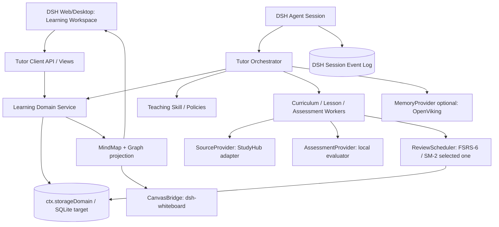
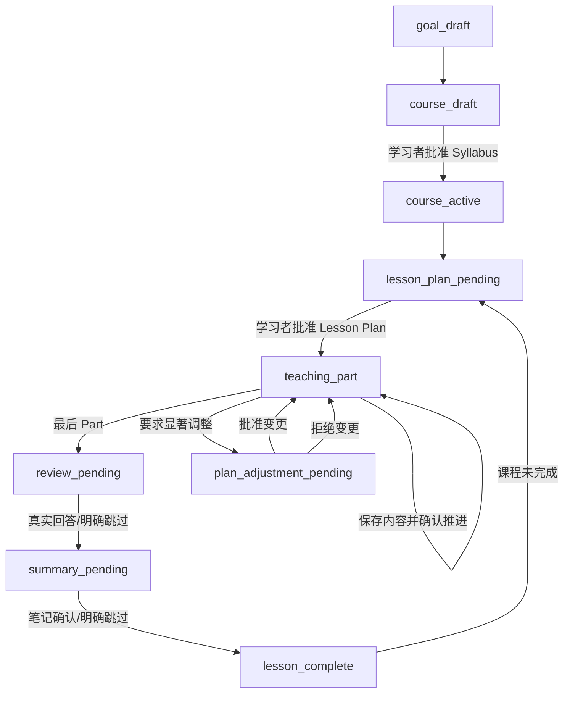

# dsh-oh-my-ai-tutor：源码调研与实施方案

> 版本：2026-11-11 / v0.1.0-prototype；以 StudyHub、LookatStudy、dsh-whiteboard 与 Heptabase AI Tutor 公开材料为基准。这里“已实现”只指本仓库初版可执行领域内核，不表示已完成 DSH 与第三方插件端到端集成。

## 阅读顺序

1. 源码研究：三个仓库各做什么、做不到什么，与 Heptabase 有哪些差异。
2. 架构设计：统一学习领域、教学状态机、知识可视化、Web/Desktop 适配。
3. 产品需求：完整用户旅程、功能清单、P0/P1/P2 验收。
4. 插件适配：StudyHub、LookatStudy、dsh-whiteboard 如何连接，不能直接双写的原因。
5. 评估方案：流程测试与学习效果验证分开。
6. 实施路线：交付物、阶段门禁与未完风险。

**总体决策：** 将 DSH 作为 Agent 和 UI 宿主，建立独立 `TutorDomain` 作为 Goal/Course/Syllabus/KnowledgePoint/Lesson/Assessment 的唯一权威数据源；StudyHub 提供资料与引用、LookatStudy 提供教学/知识追踪算法和 UI 参考、dsh-whiteboard 提供图形操作能力。课程大纲、思维导图、知识语义图谱和白板均共享稳定知识点 ID，但语义关系与视觉布局分离。


---

# 源码研究：DSH 学习插件 × Heptabase AI Tutor

> 研究基线：2026-11-11；检查公开默认分支的 README、docs、部分真实源码与测试。不同项目更新频繁，实施时应锁定 commit/tag。**已在源码定义**不等于**真实端到端验证**。此文不把项目的未实施计划算作当前功能。

## 1. Heptabase：比较基准

官方产品页：https://heptabase.com/ai-tutor
官方更新日志：https://wiki.heptabase.com/changelog
早期提示词研究（不等于官方授权源）：https://github.com/MarlinDiary/hepta-mirror
可执行学习 Skill 参考：https://github.com/togo13duke/heptabase-ai-tutor-skill

官方展示的主链：**学习目标与资料 → 课程大纲 → 每次 Lesson 计划 → Part 教学与交互 → Review → Lesson Note/Whiteboard → 继续下一课**。课程计划可以经反馈更改。Mirror 研究材料将工作分成 `goalSetup/courseCreation/lessonPlanning/lessonTeaching/lessonReview/lessonEnding/planAdjustment`，另有 Syllabus、Part、Note 三种生成子 Agent 的 Prompt 文档。它是早期版本的第三方整理，不能代表 2026 年 11 月全部官方功能，也不是完整可运行程序。其文字的复制/授权存在风险，因此本项目独立编写教学规则。

注意：Heptabase 官方的白板是长期个人知识管理环境，但不应据此断言“AI Tutor 自动输出思维导图、完整语义知识图谱并持续自动双向同步”是必经流程。我们的三种知识可视化是**自主增加的目标能力**。

## 2. StudyHub

仓库：https://github.com/EricWang1358/dsh-web-studyhub
重点源码/文档：
- `docs/architecture.md`：真实 `studyRuntime` 服务、多个 `*.v1` 领域上下文和写入权限/事务；`lib/runtime/lifecycle.js` 中 `ctx.provide('studyRuntime', api)`；通过 `forLibrary(path).invoke(domain, operation, args)`调用。
- `docs/course-outline.zh-CN.md`、`lib/course-outline-book.js`、`lib/contexts/generation/outline/`：从资料提取知识条目 → 按主题归纳 → 章/节/知识点三级总纲 → 原始来源引用、覆盖核验。记录 `courseOutline.nodes`、每个叶子的 `anchors` 和 `supersedes`。大纲由原文条目支持，而非仅根据文件名想象。
- `lib/skeleton.js`：知识骨架 `nodes`（术语、意义、属性、父级、题卡）和 `relations`。确切关系类型 `part-of/causes/contrasts/prerequisite/example-of/related`；单骨架最多 80 节点、160 关系，检查未知端点和不支持的类型。
- `docs/uml-canvas.md`、`ui/SkeletonCanvas.jsx`、`ui/skeleton-diagrams.js`：Class UML、Sequence UML，局部聚焦、搜索、缩放、布局、迷你图；这是可视化**阅读器**，不是关系图协同编辑器。
- `docs/study-workflows.zh-CN.md`：当前流程以题组、练习、AI 带学、FSRS-6 为中心。**“拟议：系统学习”明确未实现**，不可算成已经有逐核心知识点的证据验收。
- `docs/architecture.md` 存储：`study-workspace.json` manifest + hash shard，按域写入、跨域事务、迁移与备份；本地材料支持原文修订与引用验证。对于我们的 P1 资料/题库/RAG 层具有很高参考价值。

已具备：资料解析/引用、总纲、知识骨架、可视化阅读、题目生成与审核、FSRS-6 复习、学习记录。
缺口：总纲不能直接人工改写；课程学习顺序并未全部以新总纲为主；学科级概念图、生成图与手动编辑白板不自动同步；Heptabase 风格每 Part 审批的完整 Tutor 流程不等于当前 StudioHub 学习工作流。
验证边界：总纲文档自述已用合成资料和假模型核验部分流程，真实课程中生成内容质量尚未系统验证。

## 3. LookatStudy DSH Plugin

仓库：https://github.com/Kaiji-Z/dsh-plugin-lookatstudy
重点源码/文档：
- `src/index.ts`：`ctx.tools`、`ctx.systemPrompt.section/context`、`webServer`/Dashboard、插件激活状态；在没有 WebServer 的环境仍可使用工具。
- `src/state.ts`：`LearningState(version:2)`，Course→Section→Lesson；`LessonState` 包含 `ConceptDef[]`、`conceptMastery`、总 mastery、SM-2 复习状态、friction、notes、pending proposals、progress；多个 DSH Session 可绑定到 LessonThreadGroup；数据保存到插件自己的 JSON 文件。
- `src/vendor/bkt.ts`：BKT 四参数（预设），逐概念更新 P(known)；课程完成和弱项有阈值，但概率非经真实样本校准的测量值。
- `src/vendor/sm2.ts`：SM-2 复习，**不是 FSRS-6**；若采用 StudyHub 的 FSRS 需避免重复排期。
- `src/client/maprail.tsx`：课程树、状态条、弱项、到期标记；`src/client/diagrams.ts` 生成课程 Lesson 中心与概念辐射的**星型图**，不是本体论语义关系网络。布局由 `vendor/cmap-elk-layout.ts` 执行。
- `src/tools.ts`：约 31 个 `study_*` 工具，导入 Markdown/本地目录/GitHub/网页等、知识组件定义、记录回答、评估、笔记、复习、导出；`src/client/panel.tsx` 三栏学习工作台。

已具备：教学交互、KC 知识状态、课程门禁、BKT、SM-2、笔记、课时级概念星图、独立 UI。
缺口：模型判定的掌握度仍需校准；知识图不是带已验证语义类型的跨课关系图；独立 `state.json` 与 StudyHub 的 source/course/attempt 没有天然一致性，无法仅靠装两个插件整合。

## 4. dsh-whiteboard

仓库：https://github.com/Fantasy421/dsh-whiteboard
重点源码/文档：
- `src/index.mjs`：注册 `whiteboard_list`、`whiteboard_manage`、`whiteboard_read`、`whiteboard_patch` 四个 DSH 工具；工具以 `exec.agent.session.id` 作为唯一所属 Session。
- `docs/ai-tools.md`：目录版本与场景版本分开；`list → manage(如需要) → read → patch({boardId,baseRevision,operations})`；patch 支持增量 `add/update/delete`，每批最多 100 操作，禁止不读前态就重复提交；可处理节点、文字和箭头。
- `src/model.mjs`、`src/workspace.mjs`：Excalidraw Scene、对象 ID、约束验证、墓碑；前者最多 2000 元素/8 MB，后者每 Session 最多 100 个活跃白板。
- `docs/data-and-safety.md`：CAS + 对象级三方合并，冲突需重新读取；没有跨进程文件锁或真正 CRDT，也没有多人实时协同；完整 GUI 实机验收清单中存在未通过核验的路径。

已具备：可编辑图形白板、AI 写入工具、版本控制、同会话多白板、本地保存、导出。
缺口：存储归属按 Session，不是课程级；图形箭头没有 `prerequisite/contrasts/...` 等语义关系的权威映射；多个 Lesson Session 不能天然共享同一张可编辑白板。需要我们自己的知识图谱和 CanvasProjection/Bridge。

## 5. 与 Heptabase 的能力对照

| 功能 | Heptabase 基准 | StudyHub | LookatStudy | Whiteboard | Oh My 目标 |
|---|---|---|---|---|---|
| Goal Discovery | 已展示 | 部分（课程设置） | 部分（导入设计） | 无 | P0 |
| 多 Course / Goal | 已展示 | 课程集合 | 课程集合 | 无 | P0 |
| Syllabus 生成和人审 | 已展示 | 有总纲，编辑受限 | 导入/设计流程 | 无 | P0 |
| 课程 Mind Map | 我方增强需求 | 有结构与视觉能力 | 课程树 | 不生成 | P0 投影、P1 互动 |
| 带类型 KG | 我方增强需求 | 有知识骨架/关系类型 | 课时星型图 | 只有形状 | P0 领域表、P1 UI |
| 可编辑关系白板 | 部分展示/知识管理 | 只读 UML 视图 | 课时黑板 | 有图形编辑 | P1 自动同步 |
| Lesson Plan | 已展示 | 学法/AI 带学，非同一阶段合同 | 课程导学 | 无 | P0 |
| Teaching Part | 已展示 | 有带学/讲解 | 有强交互 | 可画图 | P0 |
| Review | 已展示 | 题目和 FSRS | 问答/BKT/SM2 | 无 | P0 |
| Notes + Resume | 已展示 | 资料/记录 | 笔记/状态 | 画布 | P0/P1 |
| 学习证据验收 | 不能据功能推定完成 | 系统学习设计未实现 | BKT 初步实现 | 无 | P1/P2 |
| 可配置第三方模型 | Heptabase 取决于订阅/模式 | DSH 模型 | DSH 模型 | DSH 工具 | DSH 模型 |

## 6. 复用边界与版权

三个项目各有公开源码和许可证声明，但仍应锁版本，并检查复制的具体子模块、资源和依赖是否有独立许可证。推荐**接口级复用**而非直接拼接三个状态文件；可以借鉴思想，独立设计统一的数据契约。`hepta-mirror` 声称含反向获取的提示词，不能把其未授权文本直接作为我们仓库的发布内容。


---

# 目标架构：dsh-oh-my-ai-tutor

## 1. 架构原则

1. **Learning Domain owns learning truth**：Goal/Course/Syllabus/KnowledgePoint/Lesson/Assessment 在本插件中统一管理；别的插件是可替换的能力提供方。
2. **Tutor control plane vs content workers**：阶段转换、确认门禁属于 Orchestrator；大纲生成、内容编写、评价、笔记生成属于可替换 Worker。
3. **One semantic graph, many projections**：课程目录是树，思维导图是树的视觉投影，知识图谱是有证据的有向多关系图，白板是可编辑图形布局。它们不互相代替。
4. **Coverage != mastery**：记录学过/看过与可迁移解答的证据；模型评分须标明不确定性，不捏造掌握概率。
5. **Snapshot + immutable evidence**：课程和概念有稳定 ID / revision，原始回答、引用、评分和关系提案保留可审计记录。
6. **Plugin compatibility**：优先使用 DSH Cordis API / StorageDomain / Client Slots / User Questions；避免修改 DSH core、读取第三方私有状态文件。

## 2. 目标分层



## 3. 核心领域对象（将原型 JSON 迁移到领域 Store）

| 对象 | 主要字段 | 关键不变量 |
|---|---|---|
| `LearningGoal` | `id,learnerId,title,outcome,profile,revision` | 目标可以拥有多门 Course |
| `Course` | `id,goalId,status,syllabusRevision` | 课程目录的批准与变更可审计 |
| `Topic/Subtopic` | `id,parentId,order,title,objective,sourceRefs` | 结构修改应保留旧 ID |
| `KnowledgePoint` | `id,title,aliases,description,courseLinks,version` | 不因更名更换 ID；跨课程去重需人工核对 |
| `KnowledgeRelation` | `id,fromId,toId,type,status,evidenceRefs,revision` | 关系端点存在；前置/包含关系不得有环；候选不自动确认 |
| `LearningSession/Lesson` | `id,courseId,dshSessionIds,plan,phase,currentPart` | 属于课程，业务阶段与 DSH turn 分离 |
| `LessonPart` | `id,title,objective,content,sourceRefs,status` | 有内容、用户确认才覆盖，不等于掌握 |
| `AssessmentEvidence` | `id,conceptId,lessonId,question,response,score,hints,rubric,origin,time` | 保存真实答案与实际提示；可追溯、不可猜测 |
| `LearnerConceptState` | `learnerId,conceptId,status,modelVersion,evidenceIds` | 进度状态与知识掌握状态分离 |
| `LearningNote` | `id,lessonId,conceptIds,body,author,sourceRefs,version` | 用户笔记与 AI 生成内容分开 |
| `SourceRef` | `id,documentId,revision,locator,quote,verified` | 原文/页码/时间戳能回溯；不可凭模型假造 |
| `CanvasBinding` | `courseId,boardId,owningSessionId,sceneRevision,conceptElementIds,relationElementIds` | 逻辑 ID ≠ 元素 ID；不能静默覆盖用户布局 |
| `ReviewItem` | `id,conceptId,questionId,scheduler,dueAt,reviewHistory` | 一条复习流仅有一个权威调度器 |

## 4. 生命周期状态机（目标）



原型具备 `plan_pending → teaching → review_pending → summary_pending → complete` 的数据状态，但**未建立真实用户身份绑定的审批令牌**。目标实现中 `approve` 接口必须接收由 DSH UI 用户操作产生、绑定 entity+revision 的 `decisionId`，不能由 Agent 自行生成。

## 5. 视觉模型：四层不可混淆

- `SyllabusTree`：严格父子树，显示计划、进度和目录；来自课程 Syllabus。
- `MindMap`：SyllabusTree 的可视化，输出 `id,title,children`，可生成 Mermaid 或 UI 的 ReactFlow 视图；仅反映“包含/课程层级”。
- `KnowledgeGraph`：独立的 `KnowledgePoint` 和 `KnowledgeRelation`，含 `prerequisite/partOf/explains/contrasts/applies/exampleOf/relatedTo` 与来源证据；支持跨章节、跨课程关系。
- `KnowledgeWhiteboard`：由图谱部分投影的 `node/arrow/text/layout`，包含讲课时的标注和用户自定义布局。白板的视觉箭头可能只是演示标记，**不得自动回写成已验证语义关系**。

### 数据变更原则

- 大纲重排：不重建 KPs，保留学习证据，只更新 `Topic/Subtopic.order`。
- 白板移动：只更新 layout，不改变关系。
- 白板新增连接：生成待审核 `KnowledgeRelation(candidate)`，要求选择关系类型/证据，确认后同步。
- 图谱新增关系：验证端点/环/来源，`candidate` 可以显示虚线；用户批准并校验后才变 `accepted`。
- 删除课程节点：不物理删除 KC/Assessment/Notes，软归档并保留来源。

## 6. Session 身份问题（关键）

`dsh-whiteboard` 的工具只能编辑**当前调用 Agent Session 所属**的白板。因此若一门 Course 有多个 Lesson DSH Session，不能直接拿别的 Session 的 boardId 去写入。

- **P0：** 知识图谱存在我们自己的 Store；`whiteboard-seed` 只是某个 Lesson Session 的投影。将 courseId 和 sceneId 留在 CanvasBinding。
- **P1 推荐：** 维护独立 `CourseBoard` 服务/Canvas UI（可复用 Excalidraw UI 和公开的数据转换思想），跨 Lesson 使用同一 `courseId` 权威知识白板；保留 dsh-whiteboard 作为外部可选的课程图形投影，使用其公开工具。
- **临时低成本路径：** 将一门 Course 的教学绑定到一个长期 DSH Session，保证其图板不散落在不同会话。弊端是长会话上下文、并发和课程/课时分组体验。

## 7. 数据同步与适配约束

- Host `TutorDomain` 保存权威学习数据；组件不直接互相读私有 JSON。
- `StudyHubAdapter` 在运行时发现 `studyRuntime`，检查 contexts/operation 版本和授权，提取 `documentId/sourceId/revision/locator/quote`；只缓存引用，不复制全部素材。
- `LookatStudyAdapter` 的原型先作为算法/样式参考；若未来复用插件，必须定义显式同步协议并解决 KC ID、评分/复习历史及线程映射，避免双写。
- `CanvasBridge` 利用 `whiteboard_list/read/patch`，带目标 session、boardId 与 CAS；任何失败都重新读取，不盲目重试。
- `ReviewScheduler` 独立接口，初期只能二选一：StudyHub FSRS-6 或 LookatStudy SM-2，不能两个同时给同一条题安排到期日。

## 8. 产品界面（Web / Desktop 共用模型）

```text
┌────────────────────────── DSH ─────────────────────────────────────────┐
│ 左导航：学习目标、课程、最近学习、今日复习                                │
├─────────────────┬───────────────────────────────┬─────────────────────┤
│ 课程树 / Syllabus│ AI Tutor 交互教学                │ 右侧知识工作台       │
│ 章节 / Knowledge │ 目标/计划/Part/Review 确认卡    │ Tabs:               │
│ 已学/未验收/弱项 │ 当前问题及学习者真实回答        │ 课程大纲             │
│ 时间与材料       │ 引用、反馈、迁移练习            │ 思维导图             │
│                 │                               │ 知识图谱             │
│                 │                               │ 课程知识白板         │
│                 │                               │ Lesson Notes         │
└─────────────────┴───────────────────────────────┴─────────────────────┘
```

第一版可仅在 DSH 常规聊天工具中跑状态操作；完整 GUI 应由独立 `dsh.client` 和 `ctx.slots` 实现，Host 保存数据，Client 订阅投影。Web 与 Desktop 使用相同的 Client 业务组件，但需分别完成 Profile/IPC/权限测试。

## 9. 真实开发中需要增加的系统能力

- `ctx.storageDomain`/SQLite、领域事务、按实体版本 CAS；P0 prototype JSON 只承诺进程内顺序写。
- UserQuestion 审批令牌、用户实际回复验证和敏感写入防护。
- 多个 Source Provider 的 chunk/page/timecode 定位与引用证据质量检查。
- 模型 Worker 的版本化 Prompt、schema-constrained 输出、失败重试和中断恢复。
- 索引/KG 合并、关系冲突审核、领域模型迁移、备份与导出。
- 多阶段 Eval 与实际学习者实验，严格区分教学过程质量和学习增益。


---

# PRD：dsh-oh-my-ai-tutor

## 1. 产品定义

独立 DSH 插件，面向系统学习复杂知识的用户，提供「学习目标 → 学习路径 → 可视化知识结构 → 分段互动教学 → 形成性评价 → 自适应下一步 → 知识沉淀与复习」闭环。参考 Heptabase AI Tutor 的课程化交互，同时将大纲、思维导图、语义知识图谱、可编辑白板设计为明确的多视图系统。

**非目标**：替代 DSH 的通用对话系统；重建一个单独的多模型平台；从 Canvas 图形坐标自动推断真实知识因果；未经实证宣传“学习效果提升百分比”；商业化复制 Heptabase 未授权提示词。

## 2. 最小成功场景（MVP）

场景：学习者希望掌握「最近发展区 ZPD、支架教学、形成性评价」并在 AI 学习产品中正确运用。

1. 在 DSH 「学习」入口新建 Goal，说明已有基础、真实场景、预期表现、来源材料。
2. Tutor 解析真正可读取的资料，生成可修改的大纲；列表显示 Topic/Subtopic、目标、前置知识、资料来源。学习者确认后才生效。
3. 同一大纲自动生成 Mind Map；知识点转为 KC，模型给出关系候选，前置/对比/应用等关系需要来源或用户确认。
4. 右侧可切换「大纲/导图/图谱/白板」，通过一个 KnowledgePoint ID 定位同一概念。白板允许手工布局与注释；语义关系修改需再确认。
5. 从课程开始 Lesson：Tutor 提出 2～5 个教学 Part 的计划，待确认后逐 Part 编写完整、有机制解释和来源的教学文本。每次生成后等待反馈。
6. 进入 Review：一问一答；答错时按需支架、复盘、提供变化情境；实际回答、帮助程度、评估依据入库。
7. 生成 Lesson Note 并询问是否保存；完成记录后可中断。下次启动读取上次位置、未验收概念与学习偏好。
8. 在已有复习历史基础上安排 FSRS/SM-2 队列，不将“看过”当作“掌握”。

## 3. 用户旅程 × 页面交互

| 步骤 | 左侧栏 | 中间 Tutor | 右侧工作台 | 数据写入 |
|---|---|---|---|---|
| Goal Discovery | 目标列表 | 背景/结果诊断 | 来源文件 | Goal/Profile |
| Syllabus Draft | 课程树草稿 | 解释顺序与调整建议 | 大纲+导图 | Draft Syllabus |
| Syllabus Approval | 显示门禁 | 用户确认（不可代答） | 差异视图 | Approved revision |
| Graph & Canvas | 已选概念 | 询问关系含义/证据 | Graph / Whiteboard | KC+candidate edges |
| Lesson Plan | 课时进度 | 教学步骤提案 | 当前 Topic | Plan pending |
| Part Teaching | 当前知识点 | 内容、示例、追问 | 讲解笔记/示意图 | Part content/coverage |
| Review | 薄弱概念 | 逐题追问、反馈 | 引用/答题过程 | Immutable assessment |
| Summary | 当前课时完成 | 归纳用户自己的结论 | Lesson Notes / Graph | Note/Progress |
| Resume | 下次待学/到期 | 想起前次内容 | 进度和弱项 | New Session binding |

### 两种交互模式

- **普通对话**：自由提问、解释某概念或对现有笔记研究，不自动修改课程或进度。
- **Tutor 教学模式**：进入显式教学状态机，能创建/修改课程、生成教学 Part、评价和复习。每个关键操作生成可审核的结构化变更。

中断后返回普通对话不会终结当前学习状态；切换回来由 Course/Lesson ID 恢复。

## 4. 功能验收和优先级

| ID | 功能 | 优先级 | 完成条件 |
|---|---|---|---|
| F01 | 目标/学习者背景 | P0 | 在第二次会话可完整读取，不重复提问已知信息 |
| F02 | 课程与大纲 | P0 | 可增删/重排、先显示 Diff 后审批、知识点 ID 不变 |
| F03 | 大纲 Mind Map | P0 | 与同版本 Syllabus 一致，节点可跳转到课程 |
| F04 | 语义知识图谱 | P0 | 有类型和来源；无效端点、重复前置、环被拒绝；未经审核只显示候选 |
| F05 | 图谱到白板投影 | P0 演示 / P1 自动化 | 首次生成可视化，重试不产生重复元素，编辑不破坏用户布局 |
| F06 | 课时计划与确认 | P0 | 计划可修改，用户明确确认前不写下一 Part |
| F07 | 逐 Part 教学 | P0 | 输出含概念机制、例子、适用边界和引用；用户可追问 |
| F08 | 课末 Review | P0 | 记录真实回答、提示、评价理由；错题有针对性反馈 |
| F09 | 进度与恢复 | P0 | 断开/重启后准确恢复未完成 Part/问题 |
| F10 | 学习笔记 | P0 | 自动笔记与用户自己的笔记分离，链接回原课时和资料 |
| F11 | StudyHub 资料管道 | P1 | PDF/PPT/网页到页码证据，拒绝伪造引用 |
| F12 | 复习调度 | P1 | 一项知识只有一个权威调度记录，不双排期 |
| F13 | 过程和学习效果评测 | P1/P2 | 通过实验可衡量概念迁移，不能以聊天满意度取代 |
| F14 | Web/Desktop | P1 | UI 在两个 Host 配置下能启动，重连保持状态，处理冲突 |

## 5. 知识可视化详细要求

### Syllabus Tree

- 课程树（Topic、Subtopic、KnowledgePoint）具有稳定 ID、顺序、来源、掌握状态与修订号。
- 每个目录节点可跳到课时、知识卡片和图谱节点；未归位材料必须显式显示。
- 大纲可以重排/合并/修改；AI 给出变更预览，用户批准后应用；删除为归档。

### Mind Map

- 由同一份 SyllabusTree 投影；支持收起/展开、选择、缩放、定位。
- 与图谱共享 Concept ID；MindMap 的父子连线只有结构意义，不自动变为知识前置关系。
- 默认先读大纲，不能因地图渲染失败而让课程规划丢失。

### Knowledge Graph

- `prerequisite`（前置）、`partOf`（属于）、`explains`（解释）、`contrasts`（对比）、`applies`（应用）、`exampleOf`（例子）、`relatedTo`（相关）。
- 每条边含 `status=candidate/accepted/rejected`、`sourceRefs`、来源定位、提议者、审阅者、时间。
- 支持邻居筛选、按关系类型过滤、依赖链、弱知识点突出显示、从图谱进入课堂。
- 前置关系不得有环；不能基于标题相似度自动确认关系；同名异义知识点需审查。

### Whiteboard

- 同一知识点对应可复用的图形元素映射，可有多个展示实例，但语义归属只有一个 KnowledgePoint ID。
- 节点位置、颜色、文字标注、临时教学连线属于 Canvas Layout，不属于领域关系。
- 新的语义边必须显式标注类型和证据，先形成候选，确认后更新 KG。
- 冲突时保留用户草稿；仅比较变更元素并通过原子 patch 处理，不清空整个白板。

## 6. 教学规则（基于学习科学的产品化约束）

- **UbD**：从可观察能力目标回推证据任务，再规划教学活动；不只是输出主题列表。
- **支架/ZPD**：从当前回答暴露的困难选择“前置知识、示例、分解、提示、独立尝试”等行为；不把主观难度选项当作精确 ZPD 测量。
- **形成性评价**：每次反馈应该影响接下来教学；保存实际回答和提示，不仅保存 AI 最终解释。
- **主动提取/迁移**：用新情境验证理解；直接复述模型给出的答案不能作为掌握证据。
- **布鲁姆分类**：目标、练习和评价至少区分理解/应用/分析等层级；不机械把六级当作强制线性顺序。
- **认知负荷**：每个 Part 聚焦一个关键问题；复杂任务允许深讲，但不要无休止堆砌与主题无关的信息。

## 7. 数据与安全

- 本地原始答案/学习计划/用户笔记可能含敏感数据；默认本地，不默认上传第三方系统。
- 外部网页/PDF/字幕视为不可信数据，不允许其改变系统 Prompt/插件设置。
- 来源文档和 AI 生成笔记分别标记 provenance；引用缺失不能宣称“有证据支持”。
- 知识状态是暂定估计，公开任何“掌握率”必须解释评估方法、模型/参数和局限。
- 白板/课程删除需用户明确确认，保留可恢复历史，失败可回退。


---

# 三个插件的适配方案（避免直接双写）

## 适配总原则

- 每个外部插件都是 `Provider`，**不是** Tutor Domain 的权威存储。
- 能通过公开 Cordis service/API 调用就不要直接读写第三方 JSON；尚无公开稳定服务的项目先使用算法或 UI 模式作参考。
- 按版本发现/检查接口；插件缺席时可降级为本地文件和文本教学，不隐式报成功。
- 任何读取写入均带 `courseId`, `knowledgePointId`, `sourceRevision`, `sessionId` 等关联键。

## A. StudyHubAdapter（P1 核心）

能力：`SourceProvider` / `CourseOutlineProvider` / `QuestionBankProvider` / `AssessmentSourceProvider`。

参考：`docs/architecture.md` 中 `studyRuntime` service，运行时的 `forLibrary(root)`、`invoke(domain, op, args)` 和 `capabilities()`；目录和知识图谱对应 `generation.courseOutline.build`、`course.outline`、`skeleton.*`，实际 domain `skeleton.v1` / `generation.v1` / `materials.v1` 需动态检查。

接口草案：

```ts
interface SourceProvider {
  import(input: {filePath?:string; url?:string; courseId:string}): Promise<{documentId:string; revision:string}>;
  getDocument(documentId:string): Promise<{pages:number; revision:string}>;
  read(ref: SourceRef): Promise<{text:string; page?:number; offset?:number; verified:boolean}>;
  findEvidence(query:string, scope:{courseId:string}): Promise<SourceRef[]>;
}
interface CourseOutlineProvider {
  generate(courseId:string, sourceIds:string[]): Promise<{jobId:string}>;
  read(courseId:string): Promise<{nodes:unknown[]; revision:string; sources:SourceRef[]}>;
}
```

实际实现步骤：先检查 `studyRuntime` 存在且已加载 Materials/Skeleton/Generation 所需 context；获取当前 session workspace 与 StudyHub library root；查询 schema；启用读取、总纲生成与原文定位；对接我们的 `SyllabusDraft` 并将其与图谱做稳定 ID 映射。重要：StudyHub 的 `courseOutline` 不可直接人工改写，我们的编辑和批准发生在自己的 Draft 中。

不直接复用：StudyHub 题组顺序作为 Tutor 的唯一教学顺序；其计划文档中未实现的系统学习八步骤；直接复制 `study-workspace.json` 作为本插件 Store。

## B. LookatStudyAdapter（P1 参考，算法可单独替换）

能力候选：`KnowledgeTrackingProvider`, `TutorPersonaProvider`, `ReviewScheduler`, `CourseUIReference`。

- `src/vendor/bkt.ts` 为纯算法参考，默认 BKT 四参数；需要明确版本/出处并通过真实学习数据校准。
- `src/vendor/sm2.ts` 是 SM-2；StudyHub 用 FSRS-6。建议 **一个复习对象只能选择一种算法**，优先在 StudioHub/Anki 中已有可靠记录的一条流上集成。
- `src/client/diagrams.ts` 星型图仅把 Lesson 连接到 KCs；**不是**可以直接调用的本体论关系图服务。
- `src/state.ts` 的 LearningState 含 course、lesson、KC 掌握度、friction、notes、线程组、proposal，具备较好参考价值，但不是第三方可直接写入的跨插件 API。

策略：首轮不直接安装并共享 LookatStudy 的 state.json；独立实现 `LearnerConceptState`，在 P1 接入一套知识追踪算法；如果后续需要兼容 LookatStudy 已有用户，单独做一次性导入与对照报告，**不保持双写**。

## C. CanvasBridge（P0 人工操作，P1 自动同步）

参照 `dsh-whiteboard`: `whiteboard_list`, `whiteboard_manage`, `whiteboard_read`, `whiteboard_patch`。

```ts
interface CanvasBinding {
  courseId: string;
  owningSessionId: string;
  boardId: string;
  boardRevision: number;
  kpToElement: Record<string,string>;
  relationToElement: Record<string,string>;
}
interface CanvasBridge {
  read(binding:CanvasBinding):Promise<{revision:number;elements:unknown[]}>;
  diff(graph:KnowledgeGraph, existing:unknown[]):Promise<WhiteboardOperation[]>;
  apply(binding:CanvasBinding, ops:WhiteboardOperation[], baseRevision:number):Promise<{revision:number}>;
}
```

### 实施顺序

1. 在当前所属 DSH Session 调用 `whiteboard_list({})`，锁定准确 `boardId`。
2. `whiteboard_read({boardId})` 获取当前 `revision`, elements, selectedIds。
3. 与我们保存的 `kpToElement` / `relationToElement` 对比，仅补不存在元素、更新自己负责的字段。
4. `whiteboard_patch({boardId,baseRevision:read.revision,operations})`；每批最多 100 操作。
5. 重新 read 确认回写；revision 改变则更新 Binding。
6. 若 revision conflict，保留当前草稿，重新读图，**重新计算 Diff**；不把旧操作改成新版本号直接重试。

### 关键限制

`whiteboard_*` 工具的 session ID 取自调用它的 Agent Session。因此在别的 Session 不可以通过随意指定 `boardId` 编辑“课程主白板”。P0 只输出 seed；P1 应建立 `CourseBoard` 的课程级存储/展示层或临时采用“同一 Course 使用一个长期 DSH Session”的策略。

`src/model.mjs` 只能识别图形操作，里面箭头不保存我们的 `relation.type` / `relation.status`。语义关系必须保留在 tutor.domain。白板中单纯拖动/连线不能直接写 accepted relation。

## D. FSRS / Anki Provider（二选一）

- 如选择 StudyHub：调用 `study_practice` / `study_workspace` 暴露的 review 流程，跟踪它返回的调度结果，不能自己平行写 dueAt。
- 如选择独立 TS-FSRS / Anki：需要明确题卡 ID、review log、desiredRetention、dueAt、学习者时间区、复习结果归属。
- 不将 BKT 概念掌握状态和 FSRS 记忆稳定性数值混为同一个字段。

## E. 学习状态恢复

- `DSH Session` 保存聊天与工具日志；`TutorDomain` 保存 Goal/Course/Lesson/Review 的业务状态。
- 推荐 `Course -> lesson -> sessionGroup` 映射，`Lesson` 可绑定多次 DSH Session；恢复从 Domain 抓取 active lesson/current Part 和 pending question，避免仅靠聊天记忆猜测。
- 需要至少一次断电/重启恢复、异常重试、会话分叉的端到端实验。


---

# 测试与验收：过程正确性 ≠ 学习效果

## 1. 测试分层

- L0：数据契约、流程状态机、ID、CAS、无效边/环、文件写入恢复。
- L1：DSH 插件加载（Web/桌面）、工具注册、权限/Session scope、UI 交互与刷新。
- L2：跨插件集成：StudyHub 来源与 Syllabus、LookatStudy/BKT 借鉴模块、dsh-whiteboard 的读→差异→写→复读。
- L3：教学任务质量：来源准确性、概念错误率、反例、解释机制、适应性提问、支架、学生回答未伪造。
- L4：真实学习者研究：前测/后测/延迟测验、迁移题、效果量和学习时间；有足够对照和样本后才宣称效果改善。

## 2. MVP 关键场景和拒绝条件

| Case | 预期 | 失败即阻断 |
|---|---|---|
| T01 | 创建 Goal + Course + Draft Syllabus | 未批准就启动 Lesson |
| T02 | Syllabus 改名/重排保留 ID | 旧学习记录与 KC 失配 |
| T03 | 课程大纲/思维导图同数据、Graph typed edges | 各视图 KPs 不一致 |
| T04 | KG 缺失端点或 prerequisite 环被拒绝 | 错误关系进入权威图 |
| T05 | 白板重复同步不重复建节点 | 丢失已有用户布局 |
| T06 | 客户端版号冲突后停止写并重新读 | 盲重试覆盖他人更改 |
| T07 | 一个 Part 完成仍不代表 mastered | 阅读即掌握 |
| T08 | 复习问题记录用户真正提交的答案 | Agent 编造用户回答 |
| T09 | Review 跳过后仍保持 unverified | 跳过反被标记已掌握 |
| T10 | 中断、重启、继续未完成问题和提示次数 | 遗忘进度或重复评分 |
| T11 | PDF 内容存在引用时定位到正确页 | 引用伪造、错页 |
| T12 | 插件在 Web/Desktop 各装一份、功能降级可见 | 认为一个 Profile 装过就全局可用 |

## 3. 评价器维度（各 0-4 分，≥3 为单项合格）

1. 目标对齐：内容和任务是否对应学习者可观察的终态。
2. 结构合理：知识前置、Topic 粒度、Part 聚焦、未学内容安排。
3. 概念准确：定义、机制、边界、反例、错误纠正。
4. 引用证据：原始来源可核验，AI 自创例子有标记。
5. 教学互动：一次一题、有真实等待和反馈，帮助等级可调整。
6. 迁移评价：新情境中能否独立应用、解释理由。
7. 学习者状态：覆盖与掌握是否区分，评估含不确定性。
8. 状态可靠性：重连/重试/并发不丢学习记录。
9. 知识图一致性：导图、KG、白板稳定 ID 且语义边被审核。
10. 用户控制：大纲/计划/知识修改需要可拒绝的用户批准。

评分是初版产品评审 Rubric，不是对学习增益的科学测量。

## 4. 真实学习对比实验设计（P2）

- 选同一主题的等价初测/迁移后测题，记录起点差异。
- A 组使用通用 DSH Chat，B 组使用 AI Tutor 流程；如样本较少，开展同学习者交叉实验但需控制顺序效应。
- 控制学习时长/资料/题目来源，记录模型和提示词版本；延迟后测检验保持。
- 关键指标：任务迁移正确率、独立完成率、延迟保持、每题提示次数、系统状态恢复准确率；不要用自评喜欢程度替代学习效果。
- 数据隐私：用虚构和用户同意数据，支持删除和导出，不公开真实答案/个人笔记。

## 5. 当前原型测试范围

`npm test`：7 个 Node 内核测试，覆盖阶段转换、无测验不掌握、语义边与环、课程 ID 保留、投影一致、进程内 CAS/顺序写。**没有对真实 DSH Web/Desktop 插件装载、真实模型质量、跨插件互通或长期学习做端到端测试。**


---

# 实施路线：尽量少重做，尽量多复用

## P0 — 独立教学闭环与视图数据（当前原型已部分实现）

任务：
- [x] 本地课程领域模型 Goal/Course/Topic/Subtopic/KC 与 JSON 事务原型。
- [x] Syllabus → MindMap/Graph/Whiteboard seed 的统一投影。
- [x] 教学阶段转换、Part 内容、暂定答题证据、Notes/Resume 的最小状态。
- [x] DSH Cordis Host 插件入口与三个模型工具。
- [x] Node 内核单测。
- [ ] 在真实 DSH Web v0.2.2-rc.1 或兼容版本安装、启动与触发工具，记录环境与测试结果。
- [ ] 用户真实审批 Gate；将工具级 `approve` 换成持久决策记录和审批令牌。
- [ ] 可视化课程树/导图/图谱的 DSH Client UI。
- [ ] Lesson Part/Review 回答 UI；保存待回复问题并跨 Session 恢复。
- [ ] 真实运行一个完整 ZPD 示例课程，记录所有状态、断点和引用缺口。

**P0 Gate**：不安装其他学习插件的情况下，课程目标→大纲→导图/图谱→分段教学→复盘→笔记→断开恢复完整走通，不能由 Agent 伪造用户回答或批准。

## P1 — 资料、白板与复习协同

任务：
- [ ] StudyHub SourceProvider（domain/context schema 探测、documentId/locator/quote/revision），并保存真实引用。
- [ ] `CourseBoard` 持久层或者受控 dsh-whiteboard Adapter（list/read/diff/patch/read-back），避免 Session 绑定问题。
- [ ] 图谱候选关系审核 UI：类型/证据/前置环检查/语义版本。
- [ ] LessonNote/KnowledgePoint 多对多链接，以及用户笔记和生成笔记分离。
- [ ] 二选一复习调度策略（FSRS-6 / SM-2），统一题目 ID 和历史。
- [ ] 将 JSON 文件转为 `ctx.storageDomain` / SQLite，按 Course/Entity 版本 CAS，可靠迁移与备份。
- [ ] Web 和 Desktop 的 UI、Profile、权限、断网、升级与多会话场景验收。

**P1 Gate**：课程上传资料后可引用页码；在不同 Lesson 学习同一 KC 时读到同一个 ID；图谱到白板多次同步幂等；带完整记录的复习可以按期重现。

## P2 — 真正的自适应教学与学习效果验证

任务：
- [ ] 独立 `AssessmentEngine`：题目 Rubric、评分理由、证据质量、模型评测盲区。
- [ ] BKT 或其他学习者模型参数校准；在足够数据前只显示“暂定掌握状态”。
- [ ] 教学策略 Policy：依据误解、前置、提示、转移表现选择下一 Part/题型。
- [ ] 延迟复测与迁移题，前后测/延迟测验证学习增益。
- [ ] 子 Agent SyllabusWriter/LessonWriter/Evaluator/NoteWriter 独立评测，并在 DSH Subagents 上编排。
- [ ] 知识跨课程去重、图谱质量审核和概念修订历史。

**P2 Gate**：连续多次学习中，系统能据学习证据改变路径；真实学习者测试显示出可解释的进步，不把结果归因于单纯对话次数增加。

## 决策建议

- 不直接 Fork 三个完整插件进行合并（各有单独 Store/Session 和 UI，改动面过大）。
- 从 StudyHub 使用公开运行时 API 和来源能力；从 LookatStudy 借鉴强教学模式和独立算法；从 dsh-whiteboard 利用公开工具协议，知识图谱仍由 Tutor Domain 掌握。
- 用户此前提出的高内聚、低耦合要求应落实为领域边界和可替换 Provider，避免超大 `TutorAgent` 文件或一个万能插件。
- 现阶段优先完成 **P0 Gate**，再决定是否抽成 NPM 包/独立子 Agent 服务。

